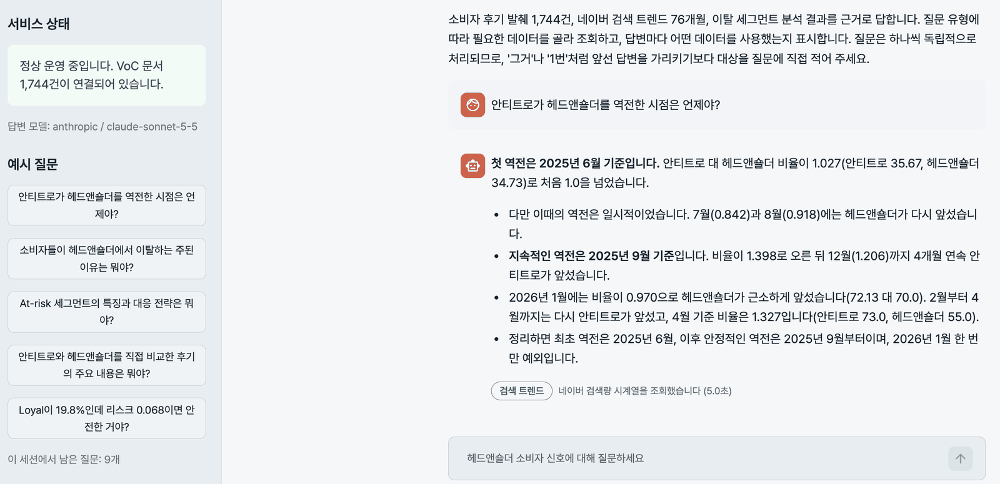
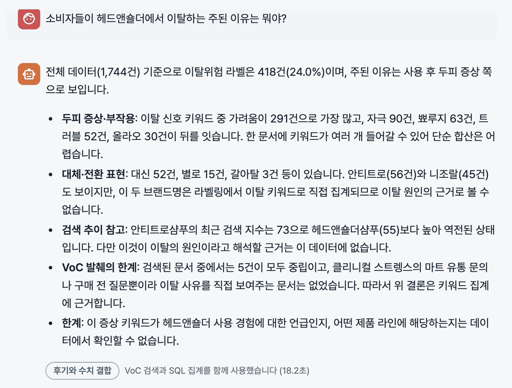
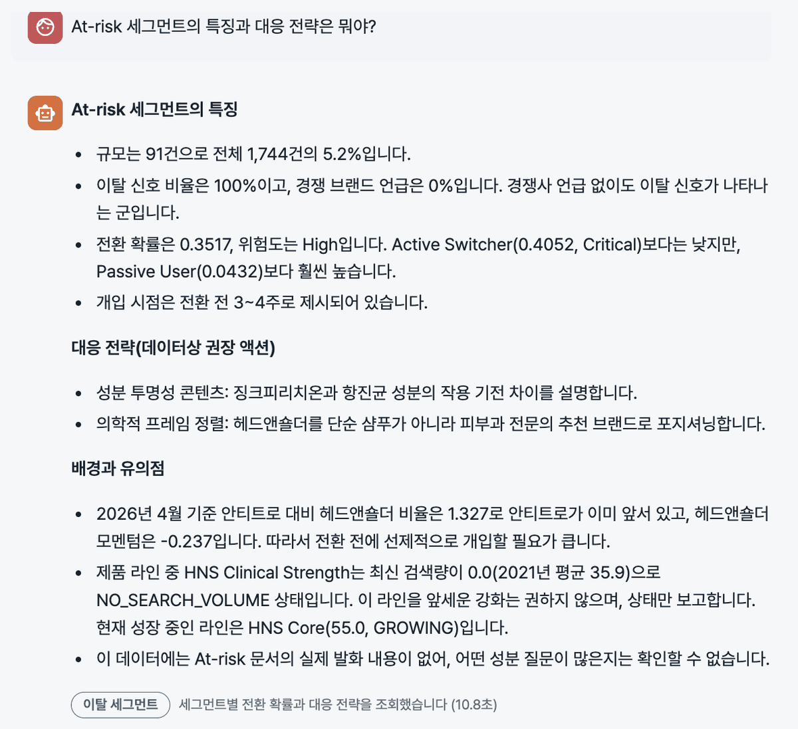
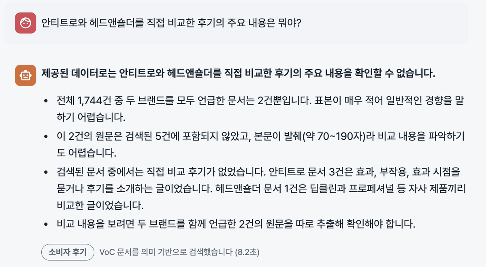
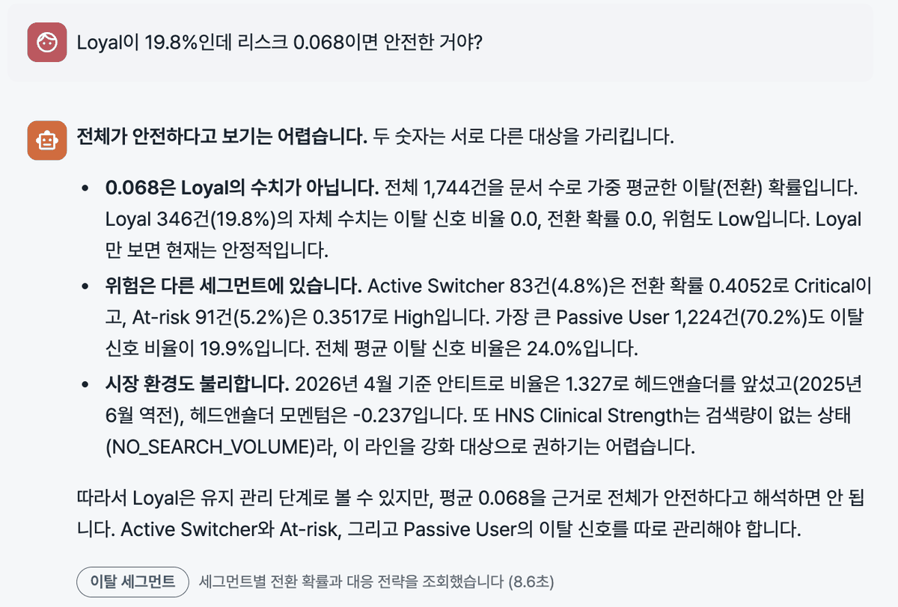
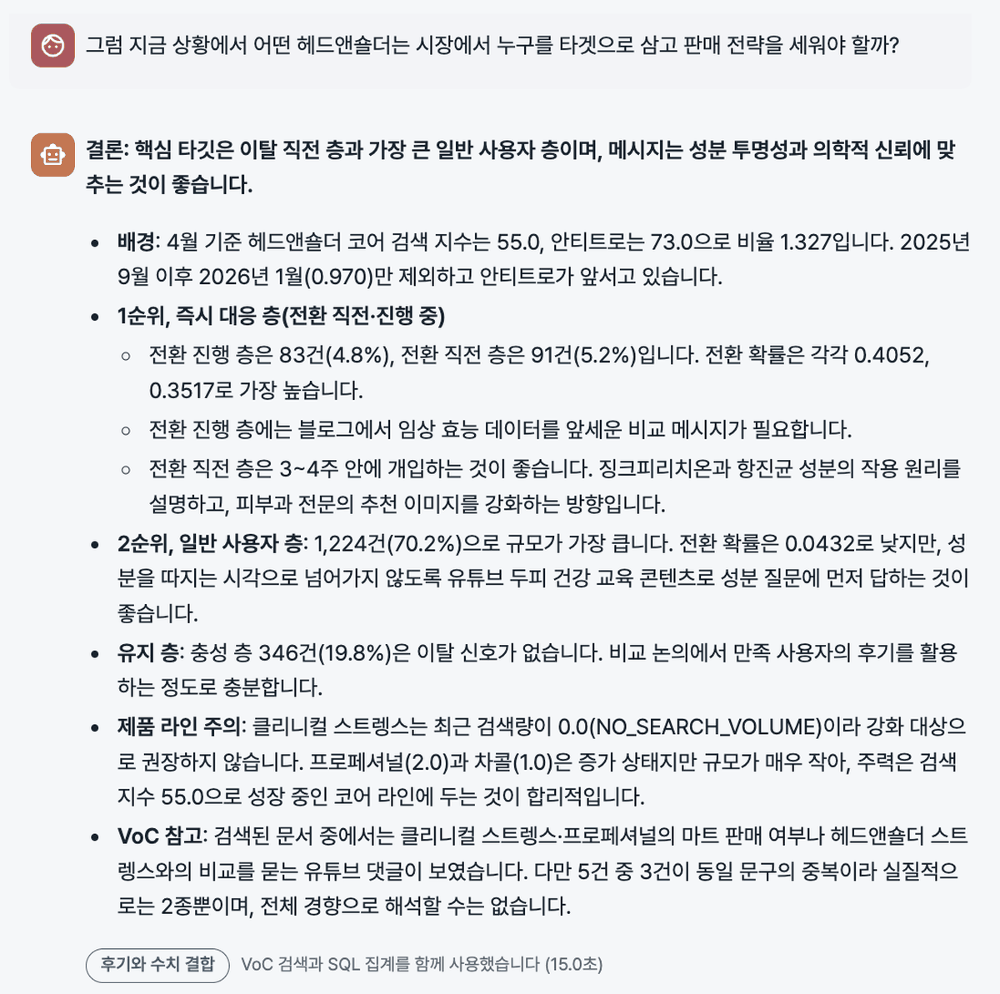
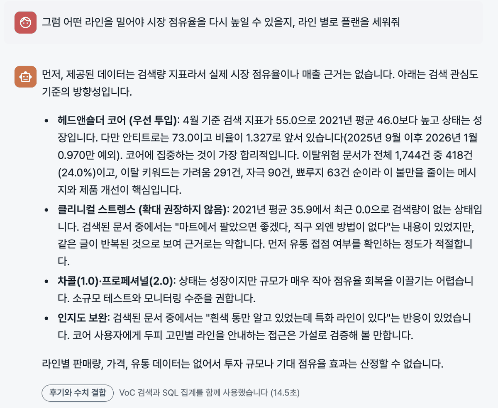
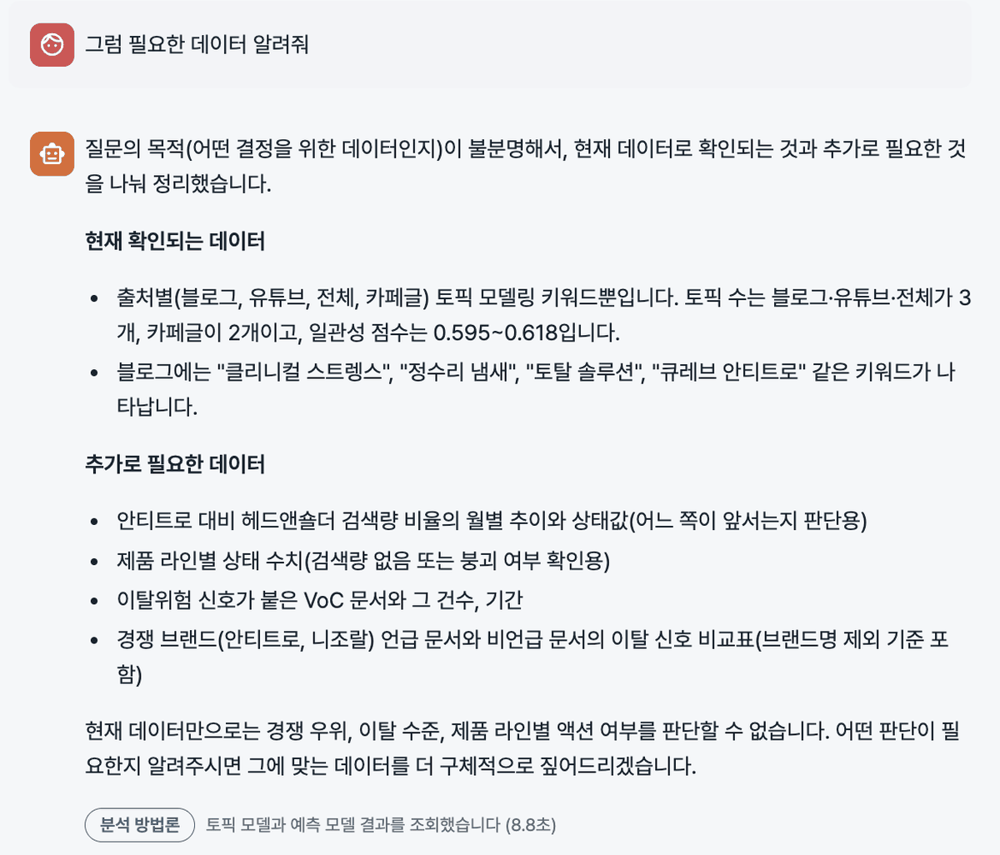

# Consumer Signal Agentic Platform

[English](README.md) | **한국어**

[H&S 3-Layer Consumer Signal Detection Pipeline](https://github.com/ChangyeolAidenOh/pg-hns-consumer-signal-pipeline)의 일회성 분석 결과를 **언제든 질문할 수 있는 시스템**으로 바꾼 **LangGraph 멀티 에이전트 플랫폼**입니다. 사용자가 소비자 전환 신호에 대해 자연어로 질문하면, 에이전트가 PostgreSQL(정형 데이터)과 ChromaDB(VoC 임베딩)로 질의를 라우팅해 데이터에 근거한 답변을 생성합니다.

> **"정적인 소비자 분석을, 브랜드 매니저든 데이터 분석가든 전략 담당자든 누구나 질문하고 3-Layer 데이터에 근거한 답을 받을 수 있는 살아 있는 시스템으로 바꿀 수 있을까?"**

**Live Demo (채팅 UI)**: [https://consumer-signal-agent.streamlit.app](https://consumer-signal-agent.streamlit.app)

**Live API (Swagger)**: [https://hns-agent-887686014711.asia-northeast3.run.app/docs](https://hns-agent-887686014711.asia-northeast3.run.app/docs)

채팅 UI는 Cloud Run API를 호출하는 Streamlit 프런트엔드입니다. 세션당 10개 질문까지 가능하고, 같은 질문은 24시간 캐시에서 응답합니다. 사이드바에는 어떤 LLM이 답하고 있는지(현재 `anthropic / claude-sonnet-5-5`)가 API health 엔드포인트에서 실시간으로 읽혀 표시됩니다.

---

## 목차

- [배경](#배경)
- [데모](#데모)
- [아키텍처](#아키텍처)
- [기술 스택](#기술-스택)
- [에이전트 설계](#에이전트-설계)
  - [Router](#router)
  - [Retriever](#retriever)
  - [Reporter](#reporter)
- [데이터 계층](#데이터-계층)
- [평가](#평가)
  - [Router 정확도](#router-정확도)
  - [평가 세트 설계](#평가-세트-설계)
  - [평가 전략 하이라이트](#평가-전략-하이라이트)
  - [카테고리별 결과](#카테고리별-결과)
- [설계 결정과 반복 기록](#설계-결정과-반복-기록)
- [채팅 프런트엔드](#채팅-프런트엔드)
- [API 레퍼런스](#api-레퍼런스)
- [배포](#배포)
- [로컬 개발](#로컬-개발)
- [프로젝트 구조](#프로젝트-구조)
- [알려진 한계와 향후 작업](#알려진-한계와-향후-작업)

---

## 배경

업스트림 [H&S 파이프라인](https://github.com/ChangyeolAidenOh/pg-hns-consumer-signal-pipeline)은 3개 분석 계층(VoC NLP, 검색 트렌드, 전환 확률)에 걸쳐 10개의 CSV 결과 파일을 생성합니다. 이 파일들에는 실행 가능한 인사이트가 담겨 있지만, 접근하려면 CSV를 열고 pandas 쿼리를 작성하고 계층 간 결과를 머릿속에서 연결해야 합니다.

이 플랫폼은 다음 방식으로 그 문제를 해결합니다.

1. **파이프라인 결과 전체를 이중 데이터 저장소에 적재**: 정형 질의는 PostgreSQL, VoC 의미 검색은 ChromaDB
2. **두 저장소 위에 LangGraph 에이전트를 얹어** 자연어로 질문할 수 있게 구성
3. **에이전트를 REST API로 서빙**해 어떤 클라우드 환경에도 배포 가능하게 구성

결과적으로 이해관계자가 "안티트로가 헤드앤숄더를 역전한 시점은 언제야?"라고 입력하면, 지어낸 답이 아니라 데이터에서 직접 나온 "2025년 6월 기준으로 역전, ratio 1.027"을 돌려받습니다.

업스트림 분석의 대표 수치 하나에 대한 참고 사항: 경쟁사를 언급한 VoC 문서의 이탈 라벨 비율은 82.2%로 그 외 문서의 20.4%보다 높지만, 업스트림 신호 탐지기가 경쟁사 브랜드명 자체를 이탈 키워드로 집계하므로 이 차이의 상당 부분은 정의에서 비롯됩니다. 브랜드명을 제외하면 이탈 신호 존재 비율은 38.6% 대 30.9%입니다(n=101에서 통계적으로 유의하지 않음). [알려진 한계](#알려진-한계와-향후-작업) 7번 항목을 참고하세요.

---

## 데모

배포된 채팅 UI(Claude Sonnet 5.5, Cloud Run, Supabase)의 스크린샷입니다. 모든 답변에는 어떤 데이터 경로를 사용했고 호출에 얼마나 걸렸는지 보여주는 라우트 배지가 붙습니다.

### 예시 질문 5개

| # | 질문 | 라우트 | 답변이 제대로 짚은 것 |
|---|------|--------|----------------------|
| 1 | 안티트로가 헤드앤숄더를 역전한 시점은 언제야? | 검색 트렌드 | 첫 역전은 2025년 6월(비율 1.027), 7월과 8월에 되돌아갔다가 9월부터 지속, 2026년 1월이 이후 유일한 예외 |
| 2 | 소비자들이 헤드앤숄더에서 이탈하는 주된 이유는 뭐야? | 후기와 수치 결합 | 1,744건 중 418건이 이탈위험 라벨(24.0%); 키워드 집계 가려움 291, 자극 90, 뾰루지 63; 브랜드명 키워드는 정의상 문제로 표시; 표본 수준 관찰과 데이터셋 수준 수치를 분리 |
| 3 | At-risk 세그먼트의 특징과 대응 전략은 뭐야? | 이탈 세그먼트 | 91건, p_switch 0.35, High; 권장 액션은 프로모션이 아니라 콘텐츠; Clinical Strength는 NO_SEARCH_VOLUME으로 보고하고 권장하지 않음 |
| 4 | 안티트로와 헤드앤숄더를 직접 비교한 후기의 주요 내용은 뭐야? | 소비자 후기 | 두 브랜드를 모두 언급한 문서는 2건뿐이고 둘 다 검색되지 않음; 비교 내용을 지어내는 대신 확인할 수 없다고 답변 |
| 5 | Loyal이 19.8%인데 리스크 0.068이면 안전한 거야? | 이탈 세그먼트 | 19.8%는 Loyal의 문서 비중, 0.068은 문서 가중 평균 전환 확률임을 구분하고, 실제 위험이 있는 곳(Active Switcher, At-risk)을 짚음 |











### 예시 밖의 질문

같은 세션에서 자유롭게 던진 질문 세 개입니다.

**"그럼 지금 상황에서 어떤 헤드앤숄더는 시장에서 누구를 타겟으로 삼고 판매 전략을 세워야 할까?"** (후기와 수치 결합)
에이전트는 Active Switcher와 At-risk를 1순위(전환 확률이 가장 높고 3~4주 안에 개입)로, 1,224건의 Passive User를 2순위(성분 비교로 넘어가기 전에 교육 콘텐츠)로, Loyal을 유지 기반으로 정리합니다. 어디에 집중할지 제안하기 전에 제품 라인 상태를 확인하고(코어 라인 GROWING, Clinical Strength NO_SEARCH_VOLUME), 검색된 발췌 5건 중 3건이 같은 문구의 중복임을 짚습니다.

**"그럼 어떤 라인을 밀어야 시장 점유율을 다시 높일 수 있을지, 라인 별로 플랜을 세워줘"** (후기와 수치 결합)
컨텍스트에 제품 라인 상태가 붙어 있으므로 에이전트는 라인별 플랜을 제시합니다. 코어 라인 방어(GROWING, 2026년 4월 55.0이지만 안티트로 73.0에 뒤처짐), Clinical Strength는 밀지 않음(2021년 평균 35.9 이후 NO_SEARCH_VOLUME), 차콜과 프로페셔널은 소규모 테스트로 취급. 마지막에는 플랜을 판단하는 데 필요한 데이터를 명시합니다.

**"그럼 필요한 데이터 알려줘"** (분석 방법론)
API는 상태가 없으므로 이전 답변에 의존하는 후속 질문에는 컨텍스트가 없습니다. 에이전트는 그 점을 밝히고, 주어진 데이터로 판단할 수 있는 것과 없는 것을 나눠 정리한 뒤 어떤 판단이 필요한지 되묻습니다. UI 안내문은 앞선 답변을 가리키는 대신 대상을 직접 적어 달라고 안내합니다.







---

## 아키텍처

```
┌─────────────────────────────────────────────────────────┐
│                      User Query                         │
│            "What are the At-risk segment features?"     |
└─────────────────────┬───────────────────────────────────┘
                      │
                      ▼
┌─────────────────────────────────────────────────────────┐
│                  LangGraph Agent                        │
│                                                         │
│  ┌──────────┐   ┌──────────┐   ┌──────────┐             │
│  │  Router   │──▶│ Retriever│──▶│ Reporter │            │
│  │ (Hybrid) │   │          │   │  (LLM)   │             │
│  └──────────┘   └────┬─────┘   └──────────┘             │
│                      │                                  │
│         ┌────────────┼────────────┐                     │
│         ▼            ▼            ▼                     │
│  ┌──────────┐ ┌──────────┐ ┌──────────┐                 │
│  │PostgreSQL│ │ ChromaDB │ │ Canned   │                 │
│  │  (SQL)   │ │  (VoC)   │ │ Queries  │                 │
│  └──────────┘ └──────────┘ └──────────┘                 │
└─────────────────────────────────────────────────────────┘
                      │
                      ▼
┌─────────────────────────────────────────────────────────┐
│                  FastAPI + Cloud Run                    │
│          POST /api/v1/analyze -> JSON response           │
└─────────────────────────────────────────────────────────┘
```

---

## 기술 스택

| 계층 | 기술 | 역할 |
|------|------|------|
| 데이터(정형) | PostgreSQL 15 | 10개 테이블, 3,694행, 트렌드·세그먼트·토픽 모델 |
| 데이터(비정형) | ChromaDB + ko-sroberta-multitask | VoC 문서 1,744건의 의미 임베딩 |
| 에이전트 | LangGraph | 3노드 그래프: Router -> Retriever -> Reporter |
| LLM(로컬 개발) | Ollama (Llama 3.1 8B) | 무료 로컬 개발과 초기 Router 평가 |
| LLM(배포) | Claude Sonnet 5.5 (Anthropic) | `langchain-anthropic`을 통한 프로덕션 API, 모델명은 `ANTHROPIC_MODEL`로 지정 |
| API | FastAPI + Pydantic | 스키마 검증이 있는 REST 엔드포인트 |
| 프런트엔드 | Streamlit (Community Cloud) | API를 호출하는 채팅 UI, 라우트 배지, `/health`에서 읽은 모델 표시 |
| 배포 | Google Cloud Run | 서버리스, asia-northeast3, 요청당 과금 |
| 데이터베이스(클라우드) | Supabase PostgreSQL | 무료 티어, Session Pooler(IPv4), 서울 리전 |
| CI/CD | GitHub Actions | push마다 린트(ruff) + 스키마 검사 + API 테스트 |
| 컨테이너 | Docker + Docker Compose | 로컬: PostgreSQL + FastAPI를 하나의 compose로 구성 |

**LLM 전환**: 같은 에이전트 코드가 `LLM_PROVIDER` 환경 변수(`ollama`, `anthropic`)로 선택한 두 백엔드에서 동작합니다. 이 변수에는 기본값이 없습니다. 변수가 없으면 프로세스가 기동을 거부하고, `/health`가 활성 provider와 모델을 보고하므로, 배포본이 의도와 다른 모델로 조용히 답하는 일은 생길 수 없습니다([설계 결정 8번](#8-암묵적-기본값이-없는-명시적-llm-설정) 참고). 로컬 개발은 Ollama(무료), 프로덕션은 Claude Sonnet 5.5(질문당 약 $0.02)를 사용합니다.

---

## 에이전트 설계

### Router

**하이브리드 라우팅: 키워드 fast-path + LLM fallback.**

Router는 들어온 질의를 `voc`, `trend`, `switching`, `mixed`, `methodology` 5개 카테고리로 분류합니다.

처음에는 LLM만으로 라우팅(Llama 3.1 8B)했는데, 한국어 질의 이해에서 기본값 편향이 생겨 분류 정확도가 44%에 그쳤습니다. 세 번의 반복을 거쳐 Router는 다음과 같이 발전했습니다.

| 버전 | 접근 | 정확도 |
|------|------|--------|
| v1 | LLM 단독 (Llama 8B) | 44% |
| v2 | LLM + 프롬프트 내 키워드 힌트 | 62% |
| v3 | 하이브리드 (키워드 fast-path + LLM fallback) | 78% -> 평가 세트 정비 후 83.1% |

하이브리드 방식은 모호하지 않은 질의를 키워드 매칭으로 즉시 라우팅하고(지연 없음, 결정적), 모호한 질의만 LLM에 위임합니다. 이 결정은 프로덕션 원칙을 반영합니다. **LLM은 가치를 더하는 곳(생성)에 쓰고, 규칙으로 충분한 곳(분류)에는 쓰지 않는다.**

### Retriever

Retriever는 질의 유형과 내용 키워드에 따라 데이터 소스를 고릅니다.

- **voc** -> ChromaDB 의미 검색(메타데이터가 붙은 상위 5개 발췌). LLM이 5개 문서 표본과 전체 데이터셋을 구분할 수 있도록 항상 데이터셋 개요(전체 발췌 수, 길이 중앙값, 라벨 집계, 경쟁사 언급)를 앞에 붙입니다. 질의에 이탈이 언급되면 SQL 이탈 신호 집계를, 경쟁사와 이탈이 함께 언급되면 경쟁사 이탈 교차표(라벨 비율과 브랜드명 제외 비율)를 추가합니다.
- **trend** -> `trend_monthly`에 대한 사전 작성 SQL. 비율 해석을 위한 `ANTITRO_LEADS` / `HNS_LEADS` 라벨과, 라인 강화 질문을 그 라인의 상태에 비추어 검토할 수 있도록 제품 라인 상태 테이블(2021년 평균 대 최신값, GROWING / DECLINING / COLLAPSED / NO_SEARCH_VOLUME)을 함께 제공합니다.
- **switching** -> 개입 전략과 조인한 세그먼트 요약, 각 세그먼트의 전체 문서 대비 비중, 문서 가중 전체 평균, 제품 라인 상태, 그리고 현재 비율에 스냅샷 월이 붙은 타임라인 사실.
- **mixed** -> ChromaDB에 키워드로 선택한 SQL을 더한 구성: 이탈 이유(`unnest` 신호 집계), 안티트로 타임라인, 세그먼트 요약, 월별 이탈, 또는 전략 번들(세그먼트 + 타임라인). 모든 mixed 컨텍스트는 데이터셋 개요로 시작해 제품 라인 상태로 끝납니다.
- **methodology** -> `lda_topics`(coherence), `bertopic_documents`(토픽 분포), `lda_bertopic_consensus`(12개 합의 신호)에 대한 SQL.

LLM fallback 앞에는 두 가지 라우팅 지름길이 있습니다. 이탈 이유 질문(이탈과 함께 이유, 원인, 왜)은 발췌와 이탈 집계가 함께 도착하도록 `mixed`로 보내고, 제품 라인명은 `trend`로 보냅니다.

핵심 설계: SQL 질의는 **사전 계산된 해석 값**(상태 라벨, 비중, 가중 평균, 스냅샷 월)을 함께 싣고, LLM은 이를 계산하는 대신 읽습니다. 이 패턴으로 비율 오해석, 날짜 오표기, 불안정한 산술 문제가 사라졌습니다. [설계 결정 1번](#1-llm-수치-추론-대신-sql-사전-계산)과 [10번](#10-프롬프트보다-데이터-계층을-먼저-고친다)을 참고하세요.

### Reporter

Reporter는 검색된 데이터에 근거한 한국어 답변을 생성합니다. 시스템 프롬프트는 세 차례 개선을 거쳤습니다.

**v1** (초기): 데이터에 근거해 답하라는 단순 지시. 비율 오해석과 날짜 형식 오류가 발생.

**v2** (해석 규칙 추가):
- **비율 의미**: "ratio ≥ 1.0이면 안티트로가 HNS를 넘어선 것. ratio < 1.0이면 HNS가 아직 앞선 것."
- **날짜 규칙**: "날짜는 월말 형식(예: 2025-06-30 = 2025년 6월). 'X월 30일 현재'가 아니라 'X월 기준'이라고 쓸 것."
- **신호 정의**: "signal=이탈위험은 이탈 위험을 뜻함. churn_score > 0이면 이탈 신호가 탐지된 것."

**v3** (가드레일 강화):
- "제공된 데이터에만 근거해 답할 것. 데이터와 모순되지 말 것."
- "VoC 문서가 불만을 보이면 불만으로 보고할 것."
- "답변은 간결하게(3~5문장). 구체적인 수치와 월을 인용할 것."

**v4** (Streamlit 테스트 이후, 근거와 해석 규칙):
- 컨텍스트를 두 개의 라벨 구역으로 분리: VoC 발췌(유사도 순 표본 5건, 전체 데이터셋에 대한 근거가 될 수 없음)와 데이터셋 수준 수치(권위 있는 값). 표본 수준 진술은 발췌가 있을 때만 "검색된 문서 중에서는"으로 시작해야 함.
- 경쟁사 이탈 수치는 항상 정의상 주의사항과 교차표의 브랜드명 제외 비교를 함께 보고해야 함.
- 제품 라인에 대한 액션을 권하기 전에 제품 라인 상태를 확인. NO_SEARCH_VOLUME이나 COLLAPSED 상태의 라인은 보고만 하고 권장하지 않음.
- 결론을 전제한 질문("~겠네?", "~맞지?")은 데이터에 비추어 평가하고, 데이터의 표현을 격상하지 않음(권장은 필수가 아님).
- 단위는 사람이 아니라 문서(건); 내부 컬럼명은 노출하지 않음; 마크다운 헤딩 없음; 최대 6문장 또는 짧은 불릿 목록.

---

## 데이터 계층

### 이중 저장소 설계

| 저장소 | 용도 | 데이터 |
|--------|------|--------|
| PostgreSQL | 정형 질의, 집계, 계층 간 JOIN | 10개 테이블, 3,694행 |
| ChromaDB | VoC 텍스트 의미 유사도 검색 | 1,744건, ko-sroberta-multitask 임베딩 |

**왜 두 저장소인가?** "경쟁사 언급 이탈률은?"은 SQL 집계(`GROUP BY competitor_mentioned`)가 필요합니다. "안티트로 비교한 사람들은 뭐라고 말했어?"는 1,744건에 대한 의미 검색이 필요합니다. 어느 한 저장소만으로는 둘 다 답할 수 없습니다. 이중 저장소 구조 덕분에 에이전트는 **통계적 근거**(SQL)와 **정성적 근거**(VoC)를 한 답변에 결합할 수 있습니다.

### PostgreSQL 스키마 (10개 테이블)

| 테이블 | 출처 | 행 수 | 주요 컬럼 |
|--------|------|-------|-----------|
| voc_documents | Layer 1 | 1,744 | source, date, raw_text, signal_type, churn_score, positive_score, competitor_mentioned |
| temporal_signals | Layer 1 | 43 | month, total, churn, positive, competitor, churn_rate, positive_rate |
| lda_topics | Layer 1 | 56 | scope, source, mode, topic_id, coherence, keywords |
| bertopic_documents | Layer 1 | 1,742 | source, date, raw_text, bertopic_id |
| lda_bertopic_consensus | Layer 1 | 12 | lda_topic, bertopic_id, overlap_keywords, confidence |
| trend_monthly | Layer 2 | 76 | date, category_click, 헤드앤숄더샴푸, 안티트로샴푸, 그 외 한국어 컬럼 14개 |
| chronos_forecast | Layer 2 | 12 | date, forecast_median, forecast_low, forecast_high |
| segment_summary | Layer 3 | 4 | segment, n_docs, churn_rate, competitor_rate, switching_probability |
| switching_implications | Layer 3 | 4 | segment, risk_level, intervention_timing, recommended_action |
| timeline_analysis | Layer 3 | 1 | antitro_first_entry, antitro_reversal_point, current_antitro_ratio |

### ChromaDB 컬렉션

- **모델**: `jhgan/ko-sroberta-multitask` (한국어 문장 임베딩, 768차원)
- **문서**: 메타데이터 필터(source, signal_type, churn_score, positive_score, net_signal, competitor_mentioned)가 붙은 VoC 텍스트 1,744건
- **메타데이터 필터링**: 필터 검색 지원. 예: `--filter-signal 이탈위험`은 이탈위험 문서만, `--filter-signal 긍정`은 긍정 문서만 반환
- **알려진 데이터 이슈**: 유튜브 댓글에 중복 항목이 있습니다(예: "헤드앤숄더쓰고 두피염증 싹나음"이 3회 등장). 인덱싱 전 중복 제거 단계를 v2에 계획하고 있습니다.

---

## 평가

### Router 정확도

**전체: 83.1% (89문항 중 74)**

| 반복 | 변경 | 정확도 |
|------|------|--------|
| v1 | LLM 단독 Router (Llama 8B) | 44.0% |
| v2 | LLM 프롬프트에 키워드 힌트 | 62.0% |
| v3 | 하이브리드 Router (키워드 fast-path + LLM fallback) + methodology 카테고리 추가 | 78.0% |
| v3 + 평가 세트 정비 | expected_type 재검토(9문항을 methodology로 재분류) + 질의 문체 정규화(일상적인 업무 말투) + 무관한 4문항 제거 | **83.1%** |

평균 응답 시간: **9.2초** (Llama 3.1 8B 로컬 추론). 배포된 Claude Sonnet 5.5는 라우트에 따라 6~17초에 답합니다(trend와 VoC 라우트가 가장 빠르고, mixed 라우트가 가장 많은 컨텍스트를 싣습니다).

### 평가 세트 설계

8개 카테고리 89문항이며, 각 문항에 `eval_category`와 `eval_strategy` 태그가 붙어 있습니다.

| 카테고리 | 문항 수 | 검증 대상 |
|----------|---------|-----------|
| fact_checking | 15 | 데이터베이스에서 정확한 수치/날짜 조회 |
| nuance_sentiment | 15 | 감성과 의도의 분리, 불확실성 탐지, 환각 저항 |
| strategic_reasoning | 10 | 인과 추론, 자원 배분, 전략적 트레이드오프, 직관에 반하는 인사이트 |
| conflict_ambiguity | 11 | 선행 지표 대 후행 지표, 평균의 함정, 모델 한계, 시나리오 플래닝 |
| edge_case | 8 | 은어 정규화, 경계 준수, 다중 의도 추출, 모순 해소 |
| domain_knowledge | 10 | 성분 트렌드, 채널 신뢰 분석, 계절 패턴, 카테고리 간 기대치 |
| pipeline_diagnostic | 10 | 복합 필터, 스키마 인식, 집계 정확도, 출력 제어(raw 대 요약) |
| methodology | 10 | LDA/BERTopic/Chronos/KMeans 방법론 지식과 선택 근거 |

### 평가 전략 하이라이트

평가 세트는 **23개의 서로 다른 eval_strategy 태그**를 사용합니다. 주요 전략과 그 의미는 다음과 같습니다.

- **`sentiment_intent_separation`**: 에이전트가 감성(긍정/부정)과 의도(유지/이탈 위험)를 구분하는지 검증합니다. 조건부로 만족한 소비자("효과는 있는데 냄새가...")는 감성은 섞여 있지만 의도는 이탈이 아니라 기능 요청입니다. 이를 혼동하면 세그먼트 배정이 틀어집니다.

- **`hallucination_test`**: 정답이 "판단할 데이터가 부족하다"인 질문을 의도적으로 던집니다. "이거 원래 거품이 안 나는 건지 불량인 건지 모르겠어요" 같은 VoC를 긍정이나 부정으로 억지 분류해서는 안 됩니다. "판단하기 어렵습니다"라고 답하는 에이전트가 분류를 지어내는 에이전트보다 높은 점수를 받습니다.

- **`business_action_differentiation`**: 에이전트가 감정 상태에 따라 다른 액션을 권하는지 검증합니다. 분노(서비스 실패) -> 즉시 보상. 실망(기대 격차) -> 제품 페이지 수정. 같은 부정 감성이라도 비즈니스 대응은 다릅니다.

- **`fallacy_of_average`**: 집계 지표가 오해를 부를 수 있음을 에이전트가 인식하는지 검증합니다. 브랜드 전체 리스크 점수 0.068은 안전해 보이지만, At-risk(91건) + Active Switcher(83건) = 사용자의 10%에 위험이 집중되어 있습니다.

- **`causal_reasoning`**: 에이전트가 인과와 상관을 구분하는지 검증합니다. 안티트로 검색량 증가와 HNS 이탈 신호는 시간적으로 상관되지만, 마케팅 전략 데이터 없이 안티트로 마케팅이 HNS 이탈을 "유발했다"고 주장해서는 안 됩니다.

- **`schema_awareness`**: 요청된 데이터 컬럼이 없을 때(예: "재구매 의사 컬럼이 있어?") 데이터를 지어내지 않고 없다고 보고하는지 검증합니다.

### 카테고리별 결과

| 카테고리 | 정확도 |
|----------|--------|
| pipeline_diagnostic | **100.0%** (10/10) |
| fact_checking | **93.3%** (14/15) |
| nuance_sentiment | **93.3%** (14/15) |
| strategic_reasoning | **80.0%** (8/10) |
| methodology | **80.0%** (8/10) |
| edge_case | **75.0%** (6/8) |
| domain_knowledge | **70.0%** (7/10) |
| conflict_ambiguity | **63.6%** (7/11) |

참고: 이 정확도는 **Router 분류**(질의가 올바른 데이터 소스로 보내졌는지)를 측정한 것이며 Llama 8B fallback으로 측정했습니다. 답변 품질은 별개의 차원입니다. 배포된 Claude Sonnet 5.5는 평가에 사용한 Llama 8B보다 더 정확하고 더 신중하게 조건을 단 답변을 내놓으며, Router fallback은 아직 Sonnet으로 재측정하지 않았습니다.

---

## 설계 결정과 반복 기록

### 1. LLM 수치 추론 대신 SQL 사전 계산

**문제**: LLM(Llama 8B)이 비율 0.334를 "역전"으로 해석해, 안티트로 역전 시점을 2025년 6월(비율 1.027)이 아니라 2025년 3월로 잘못 짚었습니다.

**해결**: SQL 질의에 `ANTITRO_LEADS` / `HNS_LEADS` 상태 라벨을 직접 추가했습니다. LLM은 부동소수점 수를 비교하는 대신 라벨을 읽습니다.

**결과**: 역전 시점이 "2025년 3월"(오답)에서 "2025년 6월"(정답)로 교정되었습니다.

**교훈**: 프로덕션 RAG 시스템에서는 해석 로직을 데이터 계층으로 내립니다. LLM은 텍스트를 생성하고, 데이터베이스는 숫자를 비교합니다.

### 2. 분석 질문에는 RAG + SQL 집계

**문제**: VoC만 검색(5건)하면 편향된 답이 나왔습니다. 예를 들어 Clinical Strength 직구 불만 한 건을 주된 이탈 이유로 인용했지만, 실제 상위 요인은 가려움(291건), 자극(90건), 뾰루지(63건)였습니다.

**해결**: ChromaDB 검색(정성적 근거가 되는 구체적 VoC 예시)과 SQL 집계(정량적 근거가 되는 `unnest` 이탈 신호 집계)를 같은 LLM 컨텍스트에 결합했습니다.

**결과**: 답변이 일화 중심("직구 불만이 원인")에서 정량 중심("가려움 291건, 자극 90건, 뾰루지 63건이 주요 이탈 원인")으로 바뀌었습니다.

**교훈**: RAG만으로는 예시를 얻고, SQL로는 통계를 얻습니다. 개별 VoC 문서는 일화적 근거를, 집계는 통계적 근거를 제공합니다. 둘을 결합해야 분석가 수준의 답이 나옵니다.

### 3. 순수 LLM Router 대신 하이브리드 Router

**문제**: Llama 8B는 한국어 5개 카테고리 분류에서 기본값 편향을 보였습니다(44%). 키워드 힌트를 넣은 프롬프트 엔지니어링으로 62%까지 올랐지만, 편향이 "trend"에서 "voc"로 옮겨갔을 뿐 근본적인 한계는 그대로였습니다.

**해결**: 모호하지 않은 질의는 키워드 기반 fast-path로, 모호한 질의는 LLM fallback으로 처리합니다. "Agentic AI" 성격(LLM이 여전히 관여)을 유지하면서 분명한 질의에서는 결정적인 정확도를 확보합니다.

**결과**: Router 정확도 44% -> 83.1%, 키워드로 매칭된 질의는 지연과 API 비용이 0.

**교훈**: "LLM을 쓸 수 있다"와 "LLM을 써야 한다"는 다른 문제입니다. 패턴이 분명한 곳은 결정적 분류, 모호한 곳은 LLM. 이는 타협이 아니라 표준적인 프로덕션 패턴입니다.

### 4. 날짜 형식 해석 규칙

**문제**: LLM이 월말로 리샘플된 날짜(`trend_monthly`의 "2026-04-30")를 "오늘 날짜"로 간주해 "2026년 4월 30일 현재"라고 보고했습니다.

**해결**: Reporter 프롬프트에 명시적 해석 규칙을 추가했습니다. "날짜는 월말 형식. 'X월 30일 현재' 대신 'X월 기준'이라고 쓸 것."

**결과**: 모든 트렌드 질의에서 날짜 표기가 교정되었습니다.

### 5. 실행 가능한 답을 위한 세그먼트 JOIN

**문제**: "At-risk 대응 전략은?"에 `segment_summary`의 세그먼트 통계(churn_rate, competitor_rate)만 돌아왔습니다. 개입 권고(risk_level, recommended_action)는 별도 테이블(`switching_implications`)에 있었습니다.

**해결**: `segment_summary`와 `switching_implications`를 하나의 SQL JOIN으로 묶어, 특성과 권장 액션을 한 컨텍스트 블록으로 LLM에 제공합니다.

**결과**: 답변에 "성분 투명성 콘텐츠, 의학적 프레임 정렬"처럼 숫자만이 아니라 세그먼트 데이터와 연결된 실행 전략이 포함됩니다.

### 6. 멀티 LLM 아키텍처

**문제**: 로컬 개발은 Ollama(Llama 3.1 8B)를 썼지만 Cloud Run에서는 Ollama를 실행할 수 없습니다(서버리스, 상주 프로세스 없음). Google Gemini 무료 티어는 요청 제한에 걸렸고, Vertex AI는 프로젝트 ID 설정 문제가 있었습니다.

**해결**: 환경 변수 기반 LLM provider 전환(`LLM_PROVIDER=ollama|anthropic`). 각 provider는 기동 시 조건부로 import됩니다. 로컬 개발은 Ollama(무료), 프로덕션은 Anthropic API를 사용합니다. Anthropic이 프로덕션 백엔드가 된 뒤 Gemini와 Vertex AI 경로는 제거했습니다.

**결과**: 코드 변경 없이 환경 변수 설정만으로 같은 에이전트 코드가 어느 백엔드에서든 동작합니다.

### 7. 런타임 인덱싱 대신 사전 구축 벡터 인덱스

**문제**: 컨테이너가 콜드 스타트마다 백그라운드 스레드에서 VoC 1,744건을 다시 임베딩했습니다. 기본 인스턴스 제한에서는 Cloud Run이 인스턴스를 더 띄우기 때문에 이 문제가 가려져 있었습니다. 비용 통제를 위해 `max-instances=1`을 설정하자 단일 인스턴스가 인덱싱 중 CPU 포화 상태에 머물렀고 모든 요청이 HTTP 429로 거부되었습니다. 요청 기반 CPU 할당은 상황을 더 악화시켰습니다. 요청을 처리하지 않는 동안에는 백그라운드 스레드가 거의 진행되지 않았습니다.

**해결**: 런타임 인덱싱을 제거했습니다. ChromaDB 인덱스는 로컬에서 한 번 구축해 이미지 안에 담습니다(`.gcloudignore`는 `chroma_data/`를 포함하고 `.gitignore`는 Git에서 제외). 디스크 포맷이 일치하도록 `chromadb`는 인덱스를 구축한 버전으로 고정했습니다.

**결과**: 콜드 스타트가 더 이상 임베딩 작업에 의존하지 않고, 단일 인스턴스 제한에서도 기동 직후 바로 응답합니다.

**교훈**: 비용이 크고 결정적인 전처리는 요청 경로가 아니라 빌드 단계에 둡니다. 비용 제한이 오토스케일링이 가려 왔던 잠재적 설계 결함을 드러냈습니다.

### 8. 암묵적 기본값이 없는 명시적 LLM 설정

**문제**: `LLM_PROVIDER`의 기본값이 `ollama`였습니다. 로컬 검증 중 셸 세션 사이에서 변수가 사라졌는데 서버는 아무 경고 없이 기동했고, "Claude" 답변이라고 생각했던 두 개가 사실은 Llama 8B가 쓴 것이었습니다. 로그에도 API 응답에도 어떤 모델이 답했는지 나오지 않았고, 단서는 답변 품질(예시 수치 복사, 브랜드명 오타, 뒤집힌 비율)뿐이었습니다.

**해결**: 설정을 `agent/config.py`로 옮겼습니다. 이 모듈은 로컬 실행 시 `.env`를 읽고 import 시점에 검증합니다. `LLM_PROVIDER`는 필수이며 `anthropic` 또는 `ollama`여야 하고, provider가 Anthropic이면 `ANTHROPIC_API_KEY`가 있어야 합니다. 잘못 설정된 프로세스는 기동 시 한 줄 오류와 함께 실패합니다. 기동 로그가 활성 provider와 모델을 출력하고, `/health`가 이를 반환하며, Streamlit 사이드바가 이를 표시합니다. `docker-compose.yml`에도 provider 기본값이 없습니다.

**결과**: 배포본이 의도하지 않은 모델로 답할 수 없고, 사용 중인 모델이 데모를 보는 누구에게나 보입니다.

**교훈**: 조용한 fallback은 개발에서는 편하지만 운영에서는 위험합니다. 선택을 명시하고, 일찍 실패하고, 사람이 볼 수 있는 곳에 드러냅니다.

### 9. 모델 업그레이드: Claude Haiku 4.5에서 Claude Sonnet 5.5로

**문제**: Streamlit 테스트에서 발견한 여러 답변 품질 문제(5건 표본을 데이터셋 전체로 취급, 유도 질문을 그대로 따라감, 검색량이 없는 제품 라인을 권장)를 프롬프트 규칙만으로 막고 있었습니다.

**해결**: Reporter와 Router fallback을 Claude Sonnet 5.5로 옮겼고, 코드 변경 없이 모델을 바꿀 수 있도록 `ANTHROPIC_MODEL`로 선택합니다. 함께 바뀐 코드가 세 가지 있습니다. `temperature`를 더 이상 설정하지 않고(Claude 5.5 모델은 기본값이 아닌 샘플링 파라미터를 거부), thinking 토큰이 한도에 포함되므로 `max_tokens`를 4096으로 올렸으며, thinking 블록과 텍스트 블록의 리스트로 도착하는 응답에서 텍스트를 추출하는 작은 헬퍼를 추가했습니다. 이미지와 로컬 환경이 같은 버전으로 돌도록 `langchain-anthropic`, `langchain-core`, Anthropic SDK를 고정했습니다.

**결과**: 검증 질문 8개를 통과합니다. "Loyal이 19.8%인데 리스크 0.068이면 안전한 거야?"에서 모델은 19.8%를 Loyal의 문서 비중으로, 0.068을 문서 가중 평균 전환 확률로 구분한 뒤 위험이 집중된 세그먼트로 주의를 돌렸습니다. 이전 모델은 질문을 그대로 받아 답했습니다. 질문당 비용은 약 $0.004에서 약 $0.02로 올랐지만, 세션당 10개 질문 제한과 24시간 답변 캐시가 있는 포트폴리오 트래픽에서는 의미 없는 수준입니다.

### 10. 프롬프트보다 데이터 계층을 먼저 고친다

**문제**: 모델 업그레이드 후 세 가지 답변 결함이 나타났습니다. 타임라인 사실 행에 날짜 없는 현재값 옆에 가속 시점 2026-01이 적혀 있어 현재 비율(1.327)이 한 번 "2026년 1월"로 보고되었고, Clinical Strength 강화에 대한 trend 라우트 질문은 trend 분기가 라인 상태를 가져오지 않아 "데이터에 없다"고 답했으며, Loyal 비중 답변은 비중과 전체 평균을 모델이 매번 계산해야 해서 불안정했습니다.

**해결**: 각 결함을 프롬프트 규칙을 하나 더 추가하는 대신 모델에 전달되는 데이터에서 고쳤습니다. `current_month` 컬럼(`trend_monthly`의 최신 월)이 현재 비율과 함께 전달되고, 제품 라인 상태가 모든 trend와 mixed 컨텍스트에 붙으며, 세그먼트 행에 `share_pct`가 실리고 한 행짜리 전체 테이블이 문서 가중 평균을 담습니다.

**결과**: 날짜가 올바른 월에 붙고, 라인 상태 답변이 더 이상 데이터가 없다고 하지 않으며, 전제 검토 답변이 실행마다 안정적입니다.

**교훈**: 모델이 컨텍스트를 잘못 읽으면 먼저 컨텍스트가 모호하지 않았는지 묻습니다. 컬럼 하나가 프롬프트의 문장 하나보다 싸고 믿을 만합니다.

---

## 채팅 프런트엔드

`frontend/app.py`는 Streamlit Community Cloud에 배포된 Streamlit 채팅 UI입니다. 얇은 클라이언트로, 모든 질문은 Cloud Run API에 대한 `POST /api/v1/analyze` 호출 하나이며, 사이드바의 서비스 상태, VoC 건수, 활성 모델은 `GET /health`에서 가져옵니다.

- 원클릭 버튼으로 제공되는 예시 질문과 자유 입력(최대 300자)
- 모든 답변 아래에 라우트 배지와 소요 시간(검색 트렌드 / 소비자 후기 / 이탈 세그먼트 / 후기와 수치 결합 / 분석 방법론)
- 세션당 10개 질문과 같은 질문에 대한 24시간 캐시로 공개 트래픽의 LLM 비용을 제한
- API는 상태가 없으므로 안내문에서 앞선 답변을 가리키는 대신 질문마다 대상을 직접 적어 달라고 안내
- 타임아웃과 서버 오류는 쉬운 말로 번역해 표시(콜드 스타트, 인스턴스 혼잡, 연결 실패)

프런트엔드는 자체 `frontend/requirements.txt`(Streamlit과 requests만)를 갖습니다. Community Cloud가 엔트리포인트 디렉터리에서 이를 읽으므로 무거운 API 의존성은 설치되지 않습니다. API 기본 URL은 `API_URL` secret 또는 환경 변수로 덮어쓸 수 있습니다.

---

## API 레퍼런스

### `POST /api/v1/analyze`

자연어 질의로 에이전트를 실행합니다.

**요청**:
```json
{
  "query": "안티트로가 헤드앤숄더를 역전한 시점은 언제야?"
}
```

**응답**:
```json
{
  "query": "안티트로가 헤드앤숄더를 역전한 시점은 언제야?",
  "query_type": "trend",
  "answer": "안티트로가 헤드앤숄더를 처음 역전한 시점은 **2025년 6월 기준**입니다. 6월에 안티트로의 비율이 1.027로 1.0을 넘으면서 처음으로 헤드앤숄더를 앞지렀습니다. 다만 7월과 8월에는 다시 헤드앤숄더가 앞서갔다가, **2025년 9월부터 안티트로가 본격적으로 우위를 점하기 시작**하여 이후 지속적으로 리드를 유지하고 있습니다."
}
```

### `GET /health`

헬스 체크: 데이터베이스 연결을 확인하고 기본 통계와 사용 중인 LLM을 반환합니다.

**응답**:
```json
{
  "status": "ok",
  "tables": 10,
  "voc_count": 1744,
  "llm_provider": "anthropic",
  "llm_model": "claude-sonnet-5-5"
}
```

---

## 배포

### 프로덕션 (Google Cloud Run)

플랫폼은 다음 구성으로 Cloud Run에 배포되어 있습니다.
- **컴퓨트**: Cloud Run (서버리스, asia-northeast3, 서울)
- **데이터베이스**: Supabase PostgreSQL (무료 티어, IPv4 호환을 위한 Session Pooler, 서울 리전)
- **LLM**: Anthropic API를 통한 Claude Sonnet 5.5 (`LLM_PROVIDER=anthropic`, `ANTHROPIC_MODEL=claude-sonnet-5-5`를 Cloud Run 환경 변수로 설정)
- **프런트엔드**: Streamlit Community Cloud에서 `frontend/app.py`가 Cloud Run API를 호출
- **VoC 임베딩**: 사전 구축한 ChromaDB 인덱스와 ko-sroberta-multitask 모델을 Docker 이미지에 포함해 콜드 스타트에서 임베딩 작업이 없음
- **CI/CD**: GitHub Actions (push마다 ruff 린트 + 스키마 검증 + API 테스트)

**비용 통제**:
- Cloud Run은 0으로 스케일되고 `max-instances=1`로 제한해 최악의 지출을 한정
- CPU 전용 PyTorch 빌드(Cloud Run에서는 CUDA 라이브러리를 쓰지 않음)로 이미지를 3.9 GB에서 0.96 GB로 줄여 레지스트리 저장 비용과 콜드 스타트 pull 시간을 절감
- Artifact Registry 정리 정책으로 최신 이미지 2개만 유지 ([`infra/artifact-cleanup-policy.json`](infra/artifact-cleanup-policy.json))
- 결제 계정에 월 예산 알림 (50% / 90% / 100% 임계값)
- Supabase 무료 티어는 7일 동안 활동이 없으면 일시 중지되므로 외부 업타임 모니터가 `/health`를 폴링해 데이터베이스를 활성 상태로 유지

예상 비용: 유휴 시 약 $0, 질문당 약 $0.02(LLM 토큰), 그리고 월 $1에 한참 못 미치는 이미지 저장 비용. 프런트엔드의 세션 제한과 답변 캐시가 공개 트래픽이 무제한 LLM 지출로 이어지지 않게 합니다.

---

## 로컬 개발

### 사전 준비

- Docker Desktop (PostgreSQL 컨테이너용)
- Python 3.10+
- LLM으로 Anthropic API 키 또는 Ollama ([ollama.com](https://ollama.com)에서 설치) 중 하나

### 빠른 시작

```bash
# Clone
git clone https://github.com/ChangyeolAidenOh/consumer-signal-agentic-platform.git
cd consumer-signal-agentic-platform

# PostgreSQL 시작 (다른 로컬 컨테이너와 충돌을 피하려고 5437 포트 사용)
docker compose up -d

# Python 환경
python3 -m venv .venv
source .venv/bin/activate
pip install -r requirements.txt

# 데이터 적재 (업스트림 파이프라인 결과 CSV 필요)
python etl/load_all.py --data-dir /path/to/pg-hns-consumer-signal-pipeline

# VoC를 ChromaDB에 인덱싱
python rag/index.py

# LLM 설정 (LLM_PROVIDER가 없으면 API가 기동을 거부)
cp .env.example .env
# .env 편집: LLM_PROVIDER=anthropic과 ANTHROPIC_API_KEY, 또는 `ollama pull llama3.1:8b` 후 LLM_PROVIDER=ollama

# API 서버 시작 (.env는 자동으로 읽힘)
uvicorn api.main:app --reload --port 8000

# Swagger UI 열기
open http://localhost:8000/docs

# 선택: 로컬 API에 대해 채팅 UI 실행
API_URL=http://localhost:8000 streamlit run frontend/app.py
```

### CLI 사용법

```bash
# 에이전트 직접 질의
python -m agent.run "안티트로가 헤드앤숄더를 역전한 시점은 언제야?"

# VoC 의미 검색
python rag/search.py "안티트로 비교 후기"
python rag/search.py --filter-signal 이탈위험 "샴푸 바꿔야 할 것 같아"

# 평가 세트 실행 (89문항, Llama 8B로 약 15분)
python -m evals.run_eval
```

### 환경 변수

변수는 환경에서 읽고, 로컬 `.env` 파일을 fallback으로 읽습니다(`.env`는 git에서 제외되며 Cloud Run 빌드에서도 제외됩니다).

| 변수 | 기본값 | 설명 |
|------|--------|------|
| DATABASE_URL | postgresql://...@localhost:5437/... | PostgreSQL 연결 문자열 |
| LLM_PROVIDER | (필수) | LLM 백엔드: `anthropic` 또는 `ollama`. 기본값 없음, 없으면 기동 실패 |
| ANTHROPIC_API_KEY | (anthropic일 때 필수) | Anthropic API 키, 기동 시 검증 |
| ANTHROPIC_MODEL | claude-sonnet-5-5 | Anthropic 모델명 |
| OLLAMA_HOST | http://localhost:11434 | Ollama 서버 URL (LLM_PROVIDER=ollama일 때) |
| OLLAMA_MODEL | llama3.1:8b | Ollama 모델명 |
| API_URL | Cloud Run URL | 프런트엔드 전용: API 기본 URL (Streamlit secrets에서도 읽음) |

---

## 프로젝트 구조

```
consumer-signal-agentic-platform/
│
├── agent/                          # LangGraph 에이전트
│   ├── config.py                   # .env 로딩, LLM provider와 모델 검증
│   ├── state.py                    # 에이전트 상태 정의 (TypedDict)
│   ├── tools.py                    # VoC 검색 (ChromaDB) + SQL 질의 (PostgreSQL)
│   ├── graph.py                    # 하이브리드 Router -> Retriever -> Reporter 그래프
│   └── run.py                      # CLI 진입점
│
├── api/                            # FastAPI 서빙 계층
│   ├── main.py                     # 엔드포인트: /api/v1/analyze, /health
│   └── schemas.py                  # Pydantic 요청/응답 모델
│
├── frontend/                       # Streamlit 채팅 UI (Community Cloud)
│   ├── app.py                      # API 채팅 클라이언트, 라우트 배지, 세션 제한
│   └── requirements.txt            # 프런트엔드 의존성만
│
├── docs/
│   ├── investigations/             # 답변 품질과 라벨링 조사 기록
│   └── screenshots/                # 이 README에 사용된 데모 스크린샷
│
├── db/                             # 데이터베이스
│   ├── schema.sql                  # PostgreSQL 스키마 (10개 테이블, 인덱스)
│   └── sample_queries.sql          # 분석 질의 (계층 간 JOIN, 집계)
│
├── etl/                            # 데이터 적재
│   ├── load_all.py                 # CSV -> PostgreSQL 로더 (환경 변수 인식)
│   └── check_columns.py           # 스키마 정렬용 CSV 컬럼 검사기
│
├── rag/                            # 벡터 검색
│   ├── index.py                    # VoC -> ChromaDB 인덱싱 (메타데이터 포함)
│   └── search.py                   # 메타데이터 필터가 있는 CLI 검색
│
├── evals/                          # 평가
│   ├── evaluation_set.json         # 89문항, 8개 카테고리, 23개 평가 전략
│   └── run_eval.py                 # 카테고리별 집계가 있는 자동 평가
│
├── tests/                          # CI 테스트
│   └── test_api.py                 # 스키마 검증 + health 엔드포인트 테스트 (DATABASE_URL은 환경에서)
│
├── .github/workflows/
│   └── ci.yml                      # GitHub Actions: push마다 ruff 린트 + pytest
│
├── infra/
│   └── artifact-cleanup-policy.json  # Artifact Registry 보존 정책 (최신 2개 유지)
├── Dockerfile                      # Cloud Run 컨테이너 (CPU 전용 PyTorch, 모델과 인덱스 포함)
├── .gcloudignore                   # 배포 업로드 규칙 (사전 구축한 chroma_data 포함)
├── startup.sh                      # 컨테이너 진입점 (PORT를 사용하는 uvicorn)
├── docker-compose.yml              # 로컬: PostgreSQL (5437) + FastAPI (8000), LLM_PROVIDER 필수
├── requirements.txt                # Python 의존성 (버전 고정)
├── .env.example                    # 환경 변수 템플릿
├── .streamlit/config.toml          # Streamlit 테마
└── .gitignore
```

---

## 알려진 한계와 향후 작업

### 현재 한계

1. **Router의 계층 간 정확도 (conflict_ambiguity 63.6%)**: VoC와 트렌드 데이터가 모두 필요한 질의가 가끔 단일 소스로 라우팅됩니다. 남은 15건의 불일치는 주로 키워드 중첩 때문입니다. 예를 들어 "카테고리 성장에도 HNS가 위험한 이유"는 "카테고리" 키워드 때문에 `trend`로 가지만 `mixed`여야 합니다. 각 카테고리를 독립적으로 점수화해 가장 높은 조합을 고르는 멀티 라벨 점수 Router가 이 구조적 한계를 해결할 수 있습니다.

2. **유튜브 댓글 중복**: 원본 데이터에 일부 유튜브 댓글이 중복되어 있습니다(예: "헤드앤숄더쓰고 두피염증 싹나음"이 3회 등장). 이는 특정 VoC 검색 결과를 부풀립니다. ChromaDB 인덱싱 전 중복 제거 단계를 계획하고 있습니다.

3. **실시간 데이터 수집 없음**: 플랫폼은 H&S 파이프라인 결과의 정적 스냅샷을 질의합니다. 새 VoC 데이터는 수동 재인덱싱(`python rag/index.py`)이 필요합니다. 자동 수집 파이프라인(Airflow/Prefect)이 있으면 지속적인 갱신이 가능합니다.

4. **단일 브랜드 범위**: 현재 H&S 대 안티트로 분석으로 한정되어 있습니다. 아키텍처는 멀티 브랜드 확장을 지원하지만 스키마 변경과 추가 데이터 수집이 필요합니다.

5. **LLM에 따라 달라지는 답변 품질**: Llama 3.1 8B(로컬)는 더 짧고 가끔 부정확한 답을 내며 프롬프트의 예시 수치를 복사합니다. Claude Sonnet 5.5(배포)는 눈에 띄게 더 정확하고 조건을 잘 답니다. 평가 결과는 Llama로 측정한 Router 분류 정확도를 반영하며, 답변 수준 평가와 Sonnet 기준 Router 재측정을 계획하고 있습니다.

6. **비교 질의의 검색 범위**: VoC 검색은 메타데이터 필터 없이 의미 유사도 상위 5건을 반환합니다. "안티트로와 헤드앤숄더를 직접 비교한 후기의 주요 내용은?"에서 검색된 문서는 단일 브랜드 후기였고, 에이전트는 비교를 지어내는 대신 직접 비교가 없다고 정확히 보고했습니다. 답은 근거에 기반했지만 재현율이 제한적이었습니다. 비교 의도를 감지해 `competitor_mentioned` 필터와 더 큰 k를 적용하면 해결할 수 있습니다.

7. **업스트림 라벨 순환성**: 업스트림 인과 신호 탐지기는 경쟁사 브랜드명 안티트로와 니조랄을 이탈 키워드 목록에 포함합니다. 이탈위험으로 라벨된 경쟁사 언급 문서 83건 중 44건은 브랜드명 외에 이탈 근거가 없고, Active Switcher 세그먼트(83건)는 정확히 이 라벨 집합입니다. 널리 인용되는 82.2% 대 20.4%의 이탈 격차는 따라서 대체로 라벨링 규칙의 결과이며, 브랜드명을 제외하면 이탈 신호 존재 비율은 38.6% 대 30.9%입니다(z ≈ 1.6, p ≈ 0.1). 두 브랜드를 모두 언급한 문서 2건은 템플릿형 홍보 글로 확인되었고, 그중 하나는 H&S에 분명히 긍정적인데도 이탈위험으로 라벨되어 있었습니다. 관련 데이터 사실: VoC "문서"는 전체 후기가 아니라 검색 API 발췌(중앙값 약 140자)이므로 청킹이 불필요하고, 직접 비교 같은 긴 맥락의 내용은 구조적으로 나타나기 어렵습니다. 업스트림 라벨링을 교정하고 세그먼테이션을 다시 돌리는 작업을 계획하고 있으며, 그때까지 에이전트는 82.2% 수치를 정의상 주의사항과 브랜드명 제외 비교와 함께 제시하도록 지시받습니다. 조사 기록: `docs/investigations/2026-10-31-answer-quality-and-label-circularity.md`.

8. **상태 없는 세션**: 각 요청은 독립적이며 API는 대화 기록을 보관하지 않습니다. 이전 답변을 가리키는 후속 질문("그럼 필요한 데이터 알려줘")은 그 맥락 없이 답변되며, 에이전트는 그 점을 밝힙니다. UI는 질문마다 대상을 적어 달라고 안내합니다. 요청에 짧은 대화 창을 더하는 확장이 가능하지만, 현재 설계가 피하고 있는 기억의 착시를 다시 들여오게 됩니다.

9. **스냅샷 데이터**: 검색 트렌드는 업스트림 파이프라인을 마지막으로 실행한 월(2026년 4월)에서 끝나며, 에이전트는 "현재" 값에 그 월을 붙여 보고합니다. 예약 작업을 통한 트렌드 테이블 월간 갱신이 첫 번째 자동화 단계이고, VoC 갱신은 업스트림 라벨링 교정(7번 항목)이 먼저입니다.

### 계획 중인 개선

- **Reporter 프롬프트의 조정 프레임워크**: 세 가지 원칙을 반영할 예정입니다. (1) 데이터 소스 위계, "검색 트렌드는 시장의 온도를 보여주고, VoC는 진단을 제공한다. 현상을 먼저 보고하고 VoC로 해석한다." (2) 평균의 함정 가드레일, "집계 지표를 인용할 때는 항상 세그먼트 수준 집중을 확인한다." (3) 한계 인정 프로토콜, "데이터가 부족하면 답을 지어내는 대신 모호함을 해소할 추가 데이터를 명시한다."

- **평가 세트 v2 보강**: ChromaDB에 합성 테스트 VoC 문서(조건부 만족, 전환 망설임, 불확실성 표현)를 추가해 Nuance & Sentiment 카테고리를 Router 수준이 아니라 답변 수준에서 직접 검증.

- **예약 트렌드 갱신**: 키워드 검색량을 가져와 `trend_monthly`를 upsert하는 월간 작업으로, 상태 라벨과 현재 비율과 스냅샷 월이 수동 재적재 없이 갱신되도록 구성.

- **Langfuse 연동**: 질의 유형별 비용, 지연, 실패율 모니터링을 위한 LLM 호출 추적.

- **멀티 라벨 Router**: 첫 매칭 키워드 라우팅 대신 5개 카테고리를 동시에 점수화해 가장 높은 조합을 선택.

---

## 관련 프로젝트

- **[H&S Consumer Signal Detection Pipeline](https://github.com/ChangyeolAidenOh/pg-hns-consumer-signal-pipeline)**: 이 플랫폼이 서빙하는 데이터를 생성하는 업스트림 3-Layer 분석 파이프라인 (VoC NLP × Trend × Switching ML)
- **[CNP VoC Pipeline](https://github.com/ChangyeolAidenOh/cnp-voc-pipeline)**: 이전 한국어 VoC 분석 프로젝트 (인과 신호 탐지, Streamlit 대시보드)
- **[ANUA Review NLP](https://github.com/ChangyeolAidenOh/anua-review-nlp)**: Amazon 리뷰 데이터를 사용한 영어 VoC 분석

---

## 라이선스

이 프로젝트는 MIT 라이선스를 따릅니다. 자세한 내용은 [LICENSE](LICENSE)를 참고하세요.
