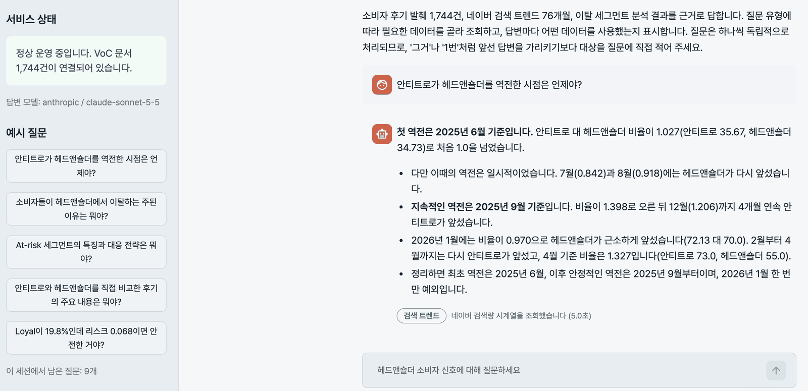
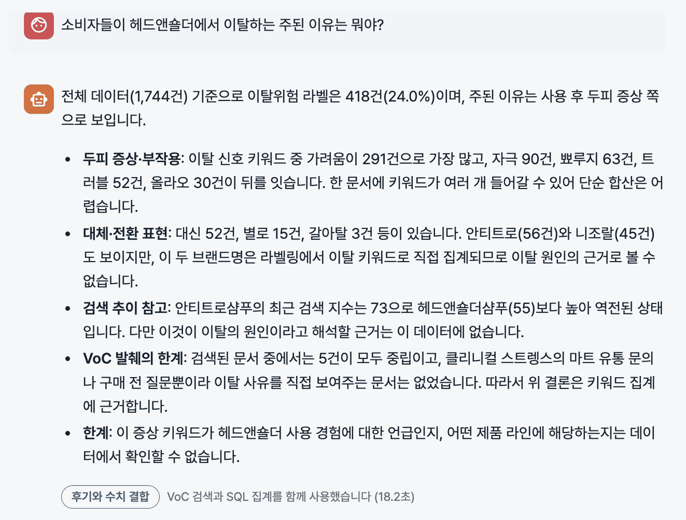
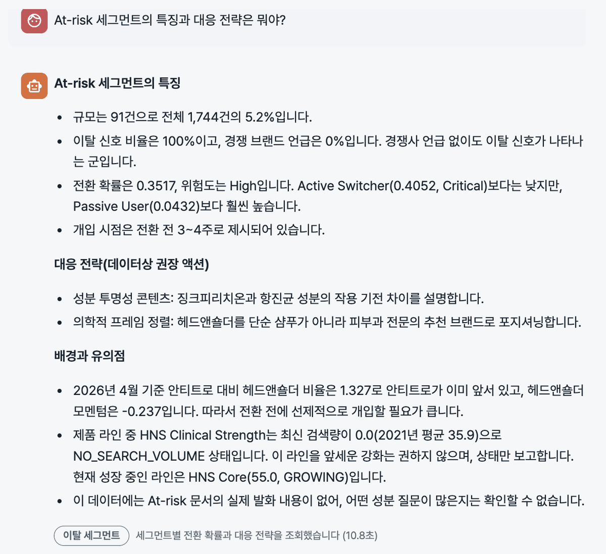
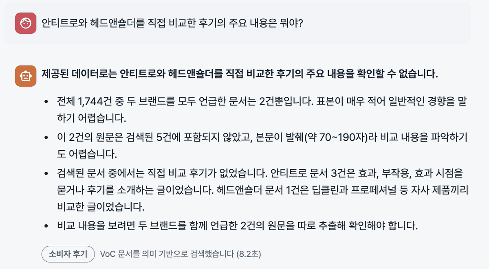
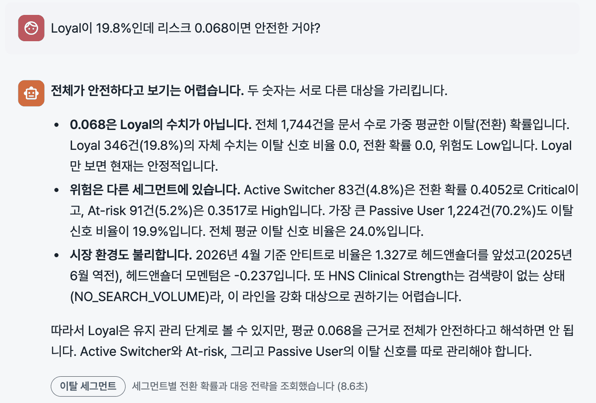
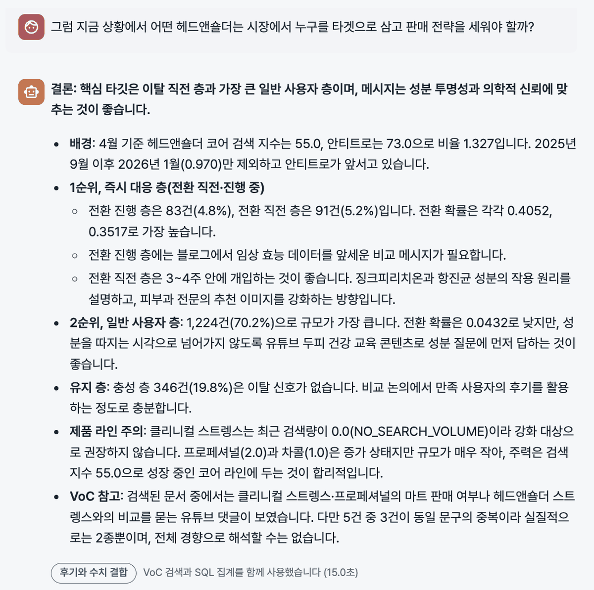
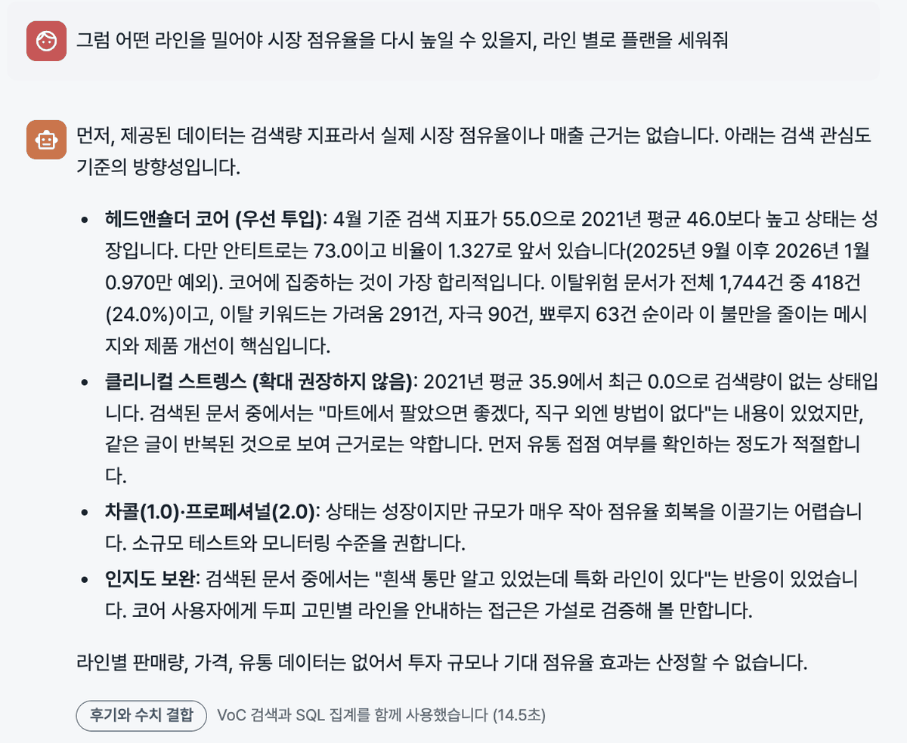
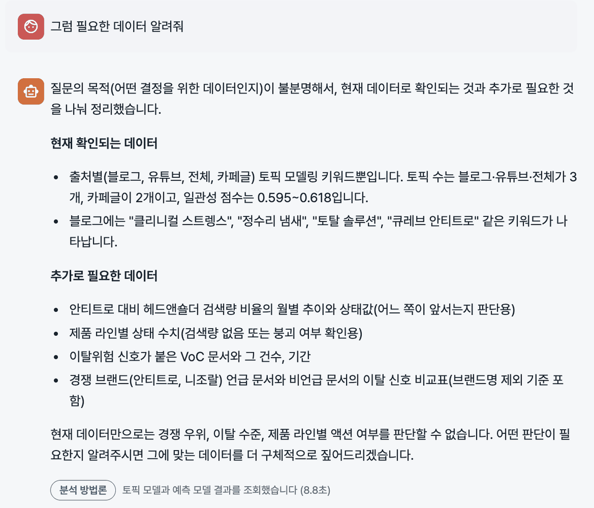

# Consumer Signal Agentic Platform

**English** | [한국어](README.ko.md)

A **LangGraph multi-agent platform** that transforms the [H&S 3-Layer Consumer Signal Detection Pipeline](https://github.com/ChangyeolAidenOh/pg-hns-consumer-signal-pipeline) from a one-time analysis into an **always-queryable system**. Users ask natural-language questions about consumer switching signals, and the agent routes queries across PostgreSQL (structured data) and ChromaDB (VoC embeddings) to generate data-grounded answers.

> **"Can we turn a static consumer analysis into a living system where any stakeholder (brand manager, data analyst, or strategist) can ask questions and get answers backed by the underlying 3-layer data?"**

**Live Demo (chat UI)**: [https://consumer-signal-agent.streamlit.app](https://consumer-signal-agent.streamlit.app)

**Live API (Swagger)**: [https://hns-agent-887686014711.asia-northeast3.run.app/docs](https://hns-agent-887686014711.asia-northeast3.run.app/docs)

The chat UI is a Streamlit front end that calls the Cloud Run API. Each session allows 10 questions and identical questions are served from a 24-hour cache. The sidebar shows which LLM is answering (currently `anthropic / claude-sonnet-5-5`), read live from the API health endpoint.

---

## Table of Contents

- [Motivation](#motivation)
- [Demo](#demo)
- [Architecture](#architecture)
- [Tech Stack](#tech-stack)
- [Agent Design](#agent-design)
  - [Router](#router)
  - [Retriever](#retriever)
  - [Reporter](#reporter)
- [Data Layer](#data-layer)
- [Evaluation](#evaluation)
  - [Router Accuracy](#router-accuracy)
  - [Evaluation Set Design](#evaluation-set-design)
  - [Evaluation Strategy Highlights](#evaluation-strategy-highlights)
  - [Category-Level Results](#category-level-results)
- [Design Decisions and Iteration Log](#design-decisions-and-iteration-log)
- [Chat Front End](#chat-front-end)
- [API Reference](#api-reference)
- [Deployment](#deployment)
- [Local Development](#local-development)
- [Project Structure](#project-structure)
- [Known Limitations and Future Work](#known-limitations-and-future-work)

---

## Motivation

The upstream [H&S pipeline](https://github.com/ChangyeolAidenOh/pg-hns-consumer-signal-pipeline) produces 10 output CSV files across 3 analytical layers (VoC NLP, search trends, switching probability). These files contain actionable insights, but accessing them requires opening CSVs, writing pandas queries, and mentally connecting findings across layers.

This platform solves that by:

1. **Loading all pipeline outputs into a dual data store**, PostgreSQL for structured queries, ChromaDB for semantic VoC search
2. **Wrapping a LangGraph agent** around both stores so users can ask questions in natural language
3. **Serving the agent as a REST API** deployable to any cloud environment

The result: a stakeholder can type "안티트로가 헤드앤숄더를 역전한 시점은 언제야?" and get back "2025년 6월 기준으로 역전, ratio 1.027", sourced directly from the data, not hallucinated.

A note on one headline figure from the upstream analysis: competitor-mentioned VoC documents show an 82.2% churn-label rate vs 20.4% for others, but the upstream signal detector counts competitor brand names themselves as churn keywords, so much of that gap is definitional. With brand names excluded, churn-signal presence is 38.6% vs 30.9% (not statistically significant at n=101). See [Known Limitations](#known-limitations-and-future-work) item 7.

---

## Demo

Screenshots from the deployed chat UI (Claude Sonnet 5.5, Cloud Run, Supabase). Every answer carries a route badge showing which data path was used and how long the call took.

### The five example questions

| # | Question | Route | What the answer gets right |
|---|----------|-------|----------------------------|
| 1 | 안티트로가 헤드앤숄더를 역전한 시점은 언제야? | 검색 트렌드 | First reversal in June 2025 (ratio 1.027), reverted in July and August, sustained from September, January 2026 as the only later exception |
| 2 | 소비자들이 헤드앤숄더에서 이탈하는 주된 이유는 뭐야? | 후기와 수치 결합 | 418 of 1,744 documents labeled churn risk (24.0%); keyword counts 가려움 291, 자극 90, 뾰루지 63; brand-name keywords flagged as definitional; sample-level observations kept separate from dataset-level figures |
| 3 | At-risk 세그먼트의 특징과 대응 전략은 뭐야? | 이탈 세그먼트 | 91 documents, p_switch 0.35, High; recommended actions are content, not promotion; Clinical Strength reported as NO_SEARCH_VOLUME and not recommended |
| 4 | 안티트로와 헤드앤숄더를 직접 비교한 후기의 주요 내용은 뭐야? | 소비자 후기 | Only 2 documents mention both brands and neither was retrieved; the agent says the comparison cannot be confirmed instead of inventing one |
| 5 | Loyal이 19.8%인데 리스크 0.068이면 안전한 거야? | 이탈 세그먼트 | Identifies 19.8% as the Loyal share of documents and 0.068 as the document-weighted average switching probability, then points to where the risk actually sits (Active Switcher, At-risk) |











### Beyond the examples

Three free-form questions asked in the same session.

**"그럼 지금 상황에서 어떤 헤드앤숄더는 시장에서 누구를 타겟으로 삼고 판매 전략을 세워야 할까?"** (후기와 수치 결합)
The agent ranks Active Switcher and At-risk as the first priority (highest switching probabilities, intervention within 3 to 4 weeks), the 1,224-document Passive User segment as the second (education content before ingredient-driven comparison), and Loyal as the retention base. It checks the product line status before suggesting where to focus (core line GROWING, Clinical Strength NO_SEARCH_VOLUME) and notes that 3 of the 5 retrieved excerpts are duplicates of the same text.

**"그럼 어떤 라인을 밀어야 시장 점유율을 다시 높일 수 있을지, 라인 별로 플랜을 세워줘"** (후기와 수치 결합)
With product line status attached to the context, the agent proposes a line-by-line plan: defend the core line (GROWING, 55.0 in April 2026 but behind Antitro at 73.0), do not push Clinical Strength (NO_SEARCH_VOLUME since its 2021 average of 35.9), and treat Charcoal and Professional as small-scale tests. It closes by naming the data that would be needed to judge the plan.

**"그럼 필요한 데이터 알려줘"** (분석 방법론)
The API is stateless, so a follow-up that depends on the previous answer has no context. The agent says so, lists what it can and cannot judge from the data it was given, and asks which topic the user means. The UI intro text tells users to name the subject directly rather than refer to earlier answers.







---

## Architecture

```
┌─────────────────────────────────────────────────────────┐
│                      User Query                         │
│            "What are the At-risk segment features?"     |
└─────────────────────┬───────────────────────────────────┘
                      │
                      ▼
┌─────────────────────────────────────────────────────────┐
│                  LangGraph Agent                        │
│                                                         │
│  ┌──────────┐   ┌──────────┐   ┌──────────┐             │
│  │  Router   │──▶│ Retriever│──▶│ Reporter │            │
│  │ (Hybrid) │   │          │   │  (LLM)   │             │
│  └──────────┘   └────┬─────┘   └──────────┘             │
│                      │                                  │
│         ┌────────────┼────────────┐                     │
│         ▼            ▼            ▼                     │
│  ┌──────────┐ ┌──────────┐ ┌──────────┐                 │
│  │PostgreSQL│ │ ChromaDB │ │ Canned   │                 │
│  │  (SQL)   │ │  (VoC)   │ │ Queries  │                 │
│  └──────────┘ └──────────┘ └──────────┘                 │
└─────────────────────────────────────────────────────────┘
                      │
                      ▼
┌─────────────────────────────────────────────────────────┐
│                  FastAPI + Cloud Run                    │
│          POST /api/v1/analyze -> JSON response           │
└─────────────────────────────────────────────────────────┘
```

---

## Tech Stack

| Layer | Technology | Role |
|-------|-----------|------|
| Data (structured) | PostgreSQL 15 | 10 tables, 3,694 rows, trends, segments, topic models |
| Data (unstructured) | ChromaDB + ko-sroberta-multitask | 1,744 VoC documents as semantic embeddings |
| Agent | LangGraph | 3-node graph: Router -> Retriever -> Reporter |
| LLM (local dev) | Ollama (Llama 3.1 8B) | Free local development and the initial router evaluation |
| LLM (deployed) | Claude Sonnet 5.5 (Anthropic) | Production API via `langchain-anthropic`, model name set by `ANTHROPIC_MODEL` |
| API | FastAPI + Pydantic | REST endpoints with schema validation |
| Front end | Streamlit (Community Cloud) | Chat UI calling the API, route badges, model shown from `/health` |
| Deployment | Google Cloud Run | Serverless, asia-northeast3, pay-per-request |
| Database (cloud) | Supabase PostgreSQL | Free tier, Session Pooler (IPv4), Seoul region |
| CI/CD | GitHub Actions | Lint (ruff) + schema check + API tests on every push |
| Containerization | Docker + Docker Compose | Local: PostgreSQL + FastAPI in single compose |

**LLM switching**: The same agent code runs on two backends selected by the `LLM_PROVIDER` environment variable (`ollama`, `anthropic`). The variable has no default: a process without it refuses to start, and `/health` reports the active provider and model, so a deployment can never silently answer with a different model than intended (see [Design Decision #8](#8-explicit-llm-configuration-with-no-silent-default)). Local development uses Ollama (free); production uses Claude Sonnet 5.5 (about $0.02 per query).

---

## Agent Design

### Router

**Hybrid routing: keyword fast-path + LLM fallback.**

The router classifies incoming queries into 5 categories: `voc`, `trend`, `switching`, `mixed`, `methodology`.

Initial approach used LLM-only routing (Llama 3.1 8B), which achieved only 44% classification accuracy due to default-value bias in Korean query understanding. Through three iterations, the router evolved:

| Version | Approach | Accuracy |
|---------|----------|----------|
| v1 | LLM-only (Llama 8B) | 44% |
| v2 | LLM + keyword hints in prompt | 62% |
| v3 | Hybrid (keyword fast-path + LLM fallback) | 78% -> 83.1% after eval set refinement |

The hybrid approach routes unambiguous queries instantly via keyword matching (zero latency, deterministic) and delegates ambiguous queries to the LLM. This decision reflects a production principle: **use LLM where it adds value (generation), not where rules suffice (classification).**

### Retriever

The retriever selects data sources based on query type and content keywords:

- **voc** -> ChromaDB semantic search (top 5 excerpts with metadata), always prefixed with a dataset overview (total excerpts, median length, label counts, competitor mentions) so the LLM can tell a 5-document sample from the whole dataset. Adds the SQL churn breakdown when the query mentions churn, and the competitor churn cross-tab (labeled rate and brand-excluded rate) when it mentions competitors and churn together.
- **trend** -> Pre-built SQL over `trend_monthly` with `ANTITRO_LEADS` / `HNS_LEADS` labels for ratio interpretation, plus the product line status table (2021 average vs latest value, GROWING / DECLINING / COLLAPSED / NO_SEARCH_VOLUME) so questions about strengthening a line are checked against that line's status.
- **switching** -> Segment summary joined with intervention strategies, each segment's share of all documents, the document-weighted overall averages, product line status, and timeline facts with the snapshot month attached to the current ratio.
- **mixed** -> ChromaDB plus keyword-selected SQL: churn reasons (`unnest` signal breakdown), antitro timeline, segment summary, monthly churn, or the strategy bundle (segments plus timeline). Every mixed context starts with the dataset overview and ends with product line status.
- **methodology** -> SQL over `lda_topics` (coherence), `bertopic_documents` (topic distribution), `lda_bertopic_consensus` (12 consensus signals).

Two routing shortcuts sit in front of the LLM fallback: churn-reason questions (이탈 together with 이유, 원인 or 왜) go to `mixed` so that excerpts and the churn breakdown arrive together, and product-line names route to `trend`.

Key design: SQL queries carry **pre-computed interpretation values** (status labels, shares, weighted averages, the snapshot month) so the LLM reads them instead of computing them. This pattern removed ratio misinterpretation, date mislabeling and unstable arithmetic. See [Design Decision #1](#1-sql-pre-computation-over-llm-numerical-reasoning) and [#10](#10-fix-the-data-layer-before-the-prompt).

### Reporter

The reporter generates Korean-language answers grounded in retrieved data. The system prompt underwent 3 iterations of improvement:

**v1** (initial): Simple instruction to answer based on data. Produced ratio misinterpretation and date format errors.

**v2** (interpretation rules added):
- **Ratio semantics**: "ratio ≥ 1.0 means Antitro surpassed HNS. ratio < 1.0 means HNS still ahead."
- **Date conventions**: "Dates use month-end format (e.g. 2025-06-30 = June 2025). Say 'X월 기준', never 'X월 30일 현재'."
- **Signal definitions**: "signal=이탈위험 means churn risk. churn_score > 0 means churn signals detected."

**v3** (guardrails strengthened):
- "Answer based ONLY on provided data. Do NOT contradict the data."
- "If VoC documents show complaints, report them as complaints."
- "Keep answers concise (3-5 sentences). Cite specific numbers and months."

**v4** (evidence and interpretation rules, after the Streamlit test):
- Context is split into two labeled sections: VoC excerpts (a similarity-ranked sample of 5, never evidence about the whole dataset) and dataset-level figures (authoritative). Sample-level statements must be phrased "검색된 문서 중에서는" and only when excerpts are present.
- The competitor churn figures must always be reported together with their definitional caveat and with the brand-excluded comparison from the cross-tab.
- Before recommending action on a product line, check the product line status; a line with NO_SEARCH_VOLUME or COLLAPSED status is reported, not recommended.
- A question that presupposes a conclusion ("~겠네?", "~맞지?") is evaluated against the data; the data's wording is never upgraded (권장 is not 필수).
- Units are documents (건), not people; internal column names are not exposed; no markdown headings; at most 6 sentences or a short bullet list.

---

## Data Layer

### Dual Storage Design

| Store | Purpose | Data |
|-------|---------|------|
| PostgreSQL | Structured queries, aggregation, cross-layer JOINs | 10 tables, 3,694 rows |
| ChromaDB | Semantic similarity search over VoC text | 1,744 documents, ko-sroberta-multitask embeddings |

**Why two stores?** "경쟁사 언급 이탈률은?" requires SQL aggregation (`GROUP BY competitor_mentioned`). "안티트로 비교한 사람들은 뭐라고 말했어?" requires semantic search across 1,744 documents. Neither store alone can answer both. This dual-store architecture enables the agent to combine **statistical evidence** (SQL) with **qualitative evidence** (VoC) in a single response.

### PostgreSQL Schema (10 tables)

| Table | Source | Rows | Key Columns |
|-------|--------|------|-------------|
| voc_documents | Layer 1 | 1,744 | source, date, raw_text, signal_type, churn_score, positive_score, competitor_mentioned |
| temporal_signals | Layer 1 | 43 | month, total, churn, positive, competitor, churn_rate, positive_rate |
| lda_topics | Layer 1 | 56 | scope, source, mode, topic_id, coherence, keywords |
| bertopic_documents | Layer 1 | 1,742 | source, date, raw_text, bertopic_id |
| lda_bertopic_consensus | Layer 1 | 12 | lda_topic, bertopic_id, overlap_keywords, confidence |
| trend_monthly | Layer 2 | 76 | date, category_click, 헤드앤숄더샴푸, 안티트로샴푸, + 14 more Korean columns |
| chronos_forecast | Layer 2 | 12 | date, forecast_median, forecast_low, forecast_high |
| segment_summary | Layer 3 | 4 | segment, n_docs, churn_rate, competitor_rate, switching_probability |
| switching_implications | Layer 3 | 4 | segment, risk_level, intervention_timing, recommended_action |
| timeline_analysis | Layer 3 | 1 | antitro_first_entry, antitro_reversal_point, current_antitro_ratio |

### ChromaDB Collection

- **Model**: `jhgan/ko-sroberta-multitask` (Korean sentence embedding, 768-dim)
- **Documents**: 1,744 VoC texts with metadata filters (source, signal_type, churn_score, positive_score, net_signal, competitor_mentioned)
- **Metadata filtering**: supports filtered search, e.g., `--filter-signal 이탈위험` returns only churn-risk documents, `--filter-signal 긍정` returns only positive documents
- **Known data issue**: YouTube comments contain duplicate entries (e.g., "헤드앤숄더쓰고 두피염증 싹나음" appears 3 times). A deduplication step before indexing is planned for v2.

---

## Evaluation

### Router Accuracy

**Overall: 83.1% (74/89 questions)**

| Iteration | Change | Accuracy |
|-----------|--------|----------|
| v1 | LLM-only router (Llama 8B) | 44.0% |
| v2 | Keyword hints in LLM prompt | 62.0% |
| v3 | Hybrid router (keyword fast-path + LLM fallback) + methodology category added | 78.0% |
| v3 + eval fix | expected_type re-examination (9 questions reclassified to methodology) + query style normalization (casual professional tone) + 4 irrelevant questions removed | **83.1%** |

Average response time: **9.2s** (Llama 3.1 8B local inference). Deployed Claude Sonnet 5.5 answers in 6 to 17 seconds depending on route (trend and VoC routes are fastest; mixed routes carry the most context).

### Evaluation Set Design

89 questions across 8 categories, each tagged with `eval_category` and `eval_strategy`:

| Category | Questions | What It Tests |
|----------|-----------|---------------|
| fact_checking | 15 | Exact number/date retrieval from database |
| nuance_sentiment | 15 | Sentiment vs intent separation, uncertainty detection, hallucination resistance |
| strategic_reasoning | 10 | Causal reasoning, resource allocation, strategic tradeoffs, counter-intuitive insights |
| conflict_ambiguity | 11 | Leading vs lagging indicators, fallacy of average, model limitations, scenario planning |
| edge_case | 8 | Slang normalization, boundary adherence, multi-intent extraction, contradiction resolution |
| domain_knowledge | 10 | Ingredient trends, channel trust analysis, seasonal patterns, cross-category expectations |
| pipeline_diagnostic | 10 | Compound filters, schema awareness, aggregation accuracy, output control (raw vs summary) |
| methodology | 10 | LDA/BERTopic/Chronos/KMeans method knowledge and selection rationale |

### Evaluation Strategy Highlights

The evaluation set employs **23 distinct eval_strategy tags**. Key strategies and why they matter:

- **`sentiment_intent_separation`**: Tests whether the agent can distinguish between sentiment (positive/negative) and intent (retention/churn risk). A conditionally satisfied consumer ("효과는 있는데 냄새가...") has mixed sentiment but Feature Request intent, not churn. Conflating these leads to incorrect segment assignment.

- **`hallucination_test`**: Deliberately asks questions where the correct answer is "insufficient data to determine." VoC like "이거 원래 거품이 안 나는 건지 불량인 건지 모르겠어요" should NOT be force-classified as positive or negative. An agent that says "판단하기 어렵습니다" scores higher than one that fabricates a classification.

- **`business_action_differentiation`**: Tests whether the agent recommends different actions for different emotional states. Anger (service failure) -> immediate compensation. Disappointment (expectation gap) -> product page revision. Same negative sentiment, different business response.

- **`fallacy_of_average`**: Tests whether the agent recognizes that aggregate metrics can be misleading. Overall brand risk score 0.068 appears safe, but At-risk (91 docs) + Active Switcher (83 docs) = 10% of users carry concentrated risk.

- **`causal_reasoning`**: Tests whether the agent claims causation vs correlation. Antitro search volume growth and HNS churn signals are temporally correlated, but without marketing strategy data, the agent should NOT claim Antitro's marketing "caused" HNS churn.

- **`schema_awareness`**: Tests whether the agent honestly reports when a requested data column does not exist (e.g., "재구매 의사 컬럼이 있어?"), rather than fabricating data.

### Category-Level Results

| Category | Accuracy |
|----------|----------|
| pipeline_diagnostic | **100.0%** (10/10) |
| fact_checking | **93.3%** (14/15) |
| nuance_sentiment | **93.3%** (14/15) |
| strategic_reasoning | **80.0%** (8/10) |
| methodology | **80.0%** (8/10) |
| edge_case | **75.0%** (6/8) |
| domain_knowledge | **70.0%** (7/10) |
| conflict_ambiguity | **63.6%** (7/11) |

Note: These accuracy scores measure **router classification** (whether the query was sent to the correct data source) and were measured with the Llama 8B fallback. Answer quality is a separate dimension; the deployed Claude Sonnet 5.5 produces more accurate and better-qualified answers than the Llama 8B used during evaluation, and the router fallback has not yet been re-measured with it.

---

## Design Decisions and Iteration Log

### 1. SQL Pre-computation over LLM Numerical Reasoning

**Problem**: LLM (Llama 8B) interpreted ratio 0.334 as "reversal", incorrectly identifying March 2025 as the Antitro reversal point instead of June 2025 (ratio 1.027).

**Solution**: Added `ANTITRO_LEADS` / `HNS_LEADS` status labels directly in the SQL query. The LLM reads labels instead of comparing floating-point numbers.

**Result**: Reversal point accuracy corrected from "2025년 3월" (wrong) to "2025년 6월" (correct).

**Takeaway**: In production RAG systems, push interpretation logic to the data layer. LLMs generate text; databases compare numbers.

### 2. RAG + SQL Aggregation for Analytical Questions

**Problem**: VoC-only retrieval (5 documents) produced biased answers, e.g., citing one Clinical Strength import complaint as the main churn reason, when the actual top drivers are 가려움 (291 cases), 자극 (90 cases), 뾰루지 (63 cases).

**Solution**: Combined ChromaDB retrieval (specific VoC examples for qualitative evidence) with SQL aggregation (`unnest` churn signal breakdown for quantitative evidence) in the same LLM context.

**Result**: Answers shifted from anecdotal ("직구 불만이 원인") to quantitative ("가려움 291건, 자극 90건, 뾰루지 63건이 주요 이탈 원인").

**Takeaway**: RAG alone gives examples; SQL gives statistics. Individual VoC documents provide anecdotal evidence, while aggregation provides statistical evidence. Combining both produces analyst-grade answers.

### 3. Hybrid Router over Pure LLM Router

**Problem**: Llama 8B showed default-value bias in Korean 5-category classification (44%). Prompt engineering with keyword hints raised accuracy to 62% but only shifted the bias from "trend" to "voc", the fundamental limitation persisted.

**Solution**: Keyword-based fast-path for unambiguous queries + LLM fallback for ambiguous ones. This preserves the "Agentic AI" aspect (LLM is still involved) while achieving deterministic accuracy on clear-cut queries.

**Result**: Router accuracy 44% -> 83.1% with lower latency and zero API cost for keyword-matched queries.

**Takeaway**: "LLM을 쓸 수 있다"와 "LLM을 써야 한다"는 다른 문제. Deterministic classification where patterns are clear; LLM where ambiguity exists. This is a standard production pattern, not a compromise.

### 4. Date Format Interpretation Rule

**Problem**: LLM reported "2026년 4월 30일 현재", treating the month-end resampled date ("2026-04-30" in `trend_monthly`) as "today's date."

**Solution**: Added explicit interpretation rule to reporter prompt: "Dates use month-end format. Say 'X월 기준' instead of 'X월 30일 현재'."

**Result**: Date references corrected across all trend queries.

### 5. Segment JOIN for Actionable Answers

**Problem**: "At-risk 대응 전략은?" returned only segment statistics (churn_rate, competitor_rate) from `segment_summary`. The intervention recommendations (risk_level, recommended_action) were stored in a separate table (`switching_implications`).

**Solution**: SQL JOIN across `segment_summary` and `switching_implications` in a single query, providing both characteristics and recommended actions to the LLM in one context block.

**Result**: Answers now include "ingredient transparency content, medical frame alignment", actionable strategy linked to specific segment data, not just numbers.

### 6. Multi-LLM Architecture

**Problem**: Local development used Ollama (Llama 3.1 8B), but Cloud Run cannot run Ollama (serverless, no persistent process). Google Gemini free tier hit rate limits. Vertex AI had project ID configuration issues.

**Solution**: Environment-variable-based LLM provider switching (`LLM_PROVIDER=ollama|anthropic`). Each provider is imported conditionally at startup. Local development uses Ollama (free); production uses the Anthropic API. The Gemini and Vertex AI paths were removed once Anthropic became the production backend.

**Result**: Same agent code runs on either backend with no code changes, only environment variable configuration.

### 7. Pre-built Vector Index over Runtime Indexing

**Problem**: The container re-embedded all 1,744 VoC documents in a background thread on every cold start. With the default instance limit this was hidden, because Cloud Run simply launched more instances. Once `max-instances=1` was set for cost control, the single instance stayed CPU-saturated during indexing and every request was rejected with HTTP 429. Request-based CPU allocation made it worse: the background thread barely progressed while no request was being served.

**Solution**: Removed runtime indexing. The ChromaDB index is built once locally and shipped inside the image (`.gcloudignore` includes `chroma_data/` while `.gitignore` keeps it out of Git). `chromadb` is pinned to the version that built the index so the on-disk format matches.

**Result**: Cold starts no longer depend on embedding work, and the service responds immediately after startup under a single-instance cap.

**Takeaway**: Expensive, deterministic preprocessing belongs in the build step, not the request path. A cost limit surfaced a latent design flaw that autoscaling had been masking.

### 8. Explicit LLM Configuration with No Silent Default

**Problem**: `LLM_PROVIDER` defaulted to `ollama`. During a local verification run the variable was lost between shell sessions, the server started without complaint, and two "Claude" answers were in fact written by Llama 8B. Nothing in the logs or the API response said which model had answered; the giveaway was the answer quality (copied example figures, a brand typo, a reversed ratio).

**Solution**: Configuration moved into `agent/config.py`, which loads `.env` for local runs and validates at import time: `LLM_PROVIDER` is required and must be `anthropic` or `ollama`, and `ANTHROPIC_API_KEY` must be present when the provider is Anthropic. A misconfigured process fails at startup with a one-line error. The startup log prints the active provider and model, `/health` returns them, and the Streamlit sidebar displays them. `docker-compose.yml` has no provider default either.

**Result**: A deployment can no longer answer with an unintended model, and the model in use is visible to anyone looking at the demo.

**Takeaway**: Silent fallbacks are convenient in development and dangerous in operation. Make the choice explicit, fail early, and surface it where people can see it.

### 9. Model Upgrade: Claude Haiku 4.5 to Claude Sonnet 5.5

**Problem**: Several answer-quality issues found in the Streamlit test (treating a 5-document sample as the dataset, following leading questions, recommending a product line with no search volume) were being held back by prompt rules alone.

**Solution**: The reporter and router fallback moved to Claude Sonnet 5.5, selected by `ANTHROPIC_MODEL` so the model can be changed without a code change. Three code changes came with it: `temperature` is no longer set (Claude 5.5 models reject non-default sampling parameters), `max_tokens` was raised to 4096 because thinking tokens count against it, and a small helper extracts text from responses that arrive as a list of thinking and text blocks. `langchain-anthropic`, `langchain-core` and the Anthropic SDK are pinned so the image and the local environment run the same versions.

**Result**: Eight verification questions pass. On "Loyal이 19.8%인데 리스크 0.068이면 안전한 거야?" the model identified 19.8% as the Loyal share of documents and 0.068 as the document-weighted average switching probability, then redirected attention to the concentrated-risk segments; the previous model had answered the question as asked. Cost per query rose from about $0.004 to about $0.02, which is immaterial at portfolio traffic with a 10-question session limit and a 24-hour answer cache.

### 10. Fix the Data Layer Before the Prompt

**Problem**: Three answer defects appeared after the model upgrade: the current ratio (1.327) was once reported as "January 2026" because the timeline facts row listed an acceleration date of 2026-01 next to an undated current value; a trend-routed question about strengthening Clinical Strength said the line status was "not in the data" because the trend branch did not fetch it; and the Loyal-share answer was unstable because the share and the overall average had to be computed by the model each time.

**Solution**: Each defect was fixed in the data passed to the model rather than with another prompt rule: a `current_month` column (the latest month in `trend_monthly`) now travels with the current ratio; product line status is attached to every trend and mixed context; segment rows carry `share_pct` and a one-row overall table carries the document-weighted averages.

**Result**: Dates attach to the right month, line-status answers no longer claim missing data, and the premise-checking answer is stable across runs.

**Takeaway**: When a model misreads the context, first ask whether the context was ambiguous. A column is cheaper and more reliable than a sentence in the prompt.

---

## Chat Front End

`frontend/app.py` is a Streamlit chat UI deployed on Streamlit Community Cloud. It is a thin client: every question is one `POST /api/v1/analyze` call to the Cloud Run API, and the service status, VoC count and active model in the sidebar come from `GET /health`.

- Example questions as one-click buttons, plus free-form input (300 characters max)
- Route badge and elapsed time under every answer (검색 트렌드 / 소비자 후기 / 이탈 세그먼트 / 후기와 수치 결합 / 분석 방법론)
- 10 questions per session and a 24-hour cache for identical questions, which bounds LLM spend from public traffic
- The API is stateless, so the intro text asks users to name the subject in each question rather than refer to earlier answers
- Timeouts and server errors are translated into plain-language messages (cold start, busy instance, connection failure)

The front end has its own `frontend/requirements.txt` (Streamlit and requests only); Community Cloud picks it up from the entrypoint directory, so the heavy API dependencies are never installed there. The API base URL can be overridden with an `API_URL` secret or environment variable.

---

## API Reference

### `POST /api/v1/analyze`

Run the agent on a natural-language query.

**Request**:
```json
{
  "query": "안티트로가 헤드앤숄더를 역전한 시점은 언제야?"
}
```

**Response**:
```json
{
  "query": "안티트로가 헤드앤숄더를 역전한 시점은 언제야?",
  "query_type": "trend",
  "answer": "안티트로가 헤드앤숄더를 처음 역전한 시점은 **2025년 6월 기준**입니다. 6월에 안티트로의 비율이 1.027로 1.0을 넘으면서 처음으로 헤드앤숄더를 앞지렀습니다. 다만 7월과 8월에는 다시 헤드앤숄더가 앞서갔다가, **2025년 9월부터 안티트로가 본격적으로 우위를 점하기 시작**하여 이후 지속적으로 리드를 유지하고 있습니다."
}
```

### `GET /health`

Health check: verifies database connectivity and returns basic stats plus the LLM in use.

**Response**:
```json
{
  "status": "ok",
  "tables": 10,
  "voc_count": 1744,
  "llm_provider": "anthropic",
  "llm_model": "claude-sonnet-5-5"
}
```

---

## Deployment

### Production (Google Cloud Run)

The platform is deployed on Cloud Run with:
- **Compute**: Cloud Run (serverless, asia-northeast3, Seoul)
- **Database**: Supabase PostgreSQL (free tier, Session Pooler for IPv4 compatibility, Seoul region)
- **LLM**: Claude Sonnet 5.5 via Anthropic API (`LLM_PROVIDER=anthropic`, `ANTHROPIC_MODEL=claude-sonnet-5-5` set as Cloud Run environment variables)
- **Front end**: Streamlit Community Cloud, serving `frontend/app.py` against the Cloud Run API
- **VoC Embeddings**: Pre-built ChromaDB index and ko-sroberta-multitask model both baked into the Docker image, so cold starts perform no embedding work
- **CI/CD**: GitHub Actions (ruff lint + schema validation + API tests on every push)

**Cost controls**:
- Cloud Run scales to zero and is capped at `max-instances=1`, bounding worst-case spend
- CPU-only PyTorch build (CUDA libraries are unused on Cloud Run) reduced the image from 3.9 GB to 0.96 GB, cutting registry storage and cold-start pull time
- Artifact Registry cleanup policy keeps only the 2 most recent images ([`infra/artifact-cleanup-policy.json`](infra/artifact-cleanup-policy.json))
- Monthly budget alert on the billing account (50% / 90% / 100% thresholds)
- Supabase free tier pauses after 7 days of inactivity; an external uptime monitor polls `/health` to keep the database active

Expected cost: ~$0 when idle, about $0.02 per query (LLM tokens), plus well under $1/month of image storage. The front end's session limit and answer cache keep public traffic from turning into open-ended LLM spend.

---

## Local Development

### Prerequisites

- Docker Desktop (for PostgreSQL container)
- Python 3.10+
- Either an Anthropic API key or Ollama (install from [ollama.com](https://ollama.com)) for the LLM

### Quick Start

```bash
# Clone
git clone https://github.com/ChangyeolAidenOh/consumer-signal-agentic-platform.git
cd consumer-signal-agentic-platform

# Start PostgreSQL (runs on port 5437 to avoid conflict with other local containers)
docker compose up -d

# Python environment
python3 -m venv .venv
source .venv/bin/activate
pip install -r requirements.txt

# Load data (requires upstream pipeline output CSVs)
python etl/load_all.py --data-dir /path/to/pg-hns-consumer-signal-pipeline

# Index VoC into ChromaDB
python rag/index.py

# Configure the LLM (the API refuses to start without LLM_PROVIDER)
cp .env.example .env
# edit .env: LLM_PROVIDER=anthropic plus ANTHROPIC_API_KEY, or LLM_PROVIDER=ollama after `ollama pull llama3.1:8b`

# Start API server (.env is loaded automatically)
uvicorn api.main:app --reload --port 8000

# Open Swagger UI
open http://localhost:8000/docs

# Optional: run the chat UI against the local API
API_URL=http://localhost:8000 streamlit run frontend/app.py
```

### CLI Usage

```bash
# Direct agent query
python -m agent.run "안티트로가 헤드앤숄더를 역전한 시점은 언제야?"

# VoC semantic search
python rag/search.py "안티트로 비교 후기"
python rag/search.py --filter-signal 이탈위험 "샴푸 바꿔야 할 것 같아"

# Run evaluation set (89 questions, ~15 min with Llama 8B)
python -m evals.run_eval
```

### Environment Variables

Variables are read from the environment, with a local `.env` file loaded as a fallback (`.env` is git-ignored and excluded from the Cloud Run build).

| Variable | Default | Description |
|----------|---------|-------------|
| DATABASE_URL | postgresql://...@localhost:5437/... | PostgreSQL connection string |
| LLM_PROVIDER | (required) | LLM backend: `anthropic` or `ollama`. No default; startup fails without it |
| ANTHROPIC_API_KEY | (required for anthropic) | Anthropic API key, validated at startup |
| ANTHROPIC_MODEL | claude-sonnet-5-5 | Anthropic model name |
| OLLAMA_HOST | http://localhost:11434 | Ollama server URL (when LLM_PROVIDER=ollama) |
| OLLAMA_MODEL | llama3.1:8b | Ollama model name |
| API_URL | Cloud Run URL | Front end only: API base URL (also readable from Streamlit secrets) |

---

## Project Structure

```
consumer-signal-agentic-platform/
│
├── agent/                          # LangGraph agent
│   ├── config.py                   # .env loading, LLM provider and model validation
│   ├── state.py                    # Agent state definition (TypedDict)
│   ├── tools.py                    # VoC search (ChromaDB) + SQL query (PostgreSQL)
│   ├── graph.py                    # Hybrid Router -> Retriever -> Reporter graph
│   └── run.py                      # CLI entry point
│
├── api/                            # FastAPI serving layer
│   ├── main.py                     # Endpoints: /api/v1/analyze, /health
│   └── schemas.py                  # Pydantic request/response models
│
├── frontend/                       # Streamlit chat UI (Community Cloud)
│   ├── app.py                      # Chat client for the API, route badges, session limit
│   └── requirements.txt            # Front end dependencies only
│
├── docs/
│   ├── investigations/             # Answer-quality and labeling investigation records
│   └── screenshots/                # Demo screenshots used in this README
│
├── db/                             # Database
│   ├── schema.sql                  # PostgreSQL schema (10 tables, indexes)
│   └── sample_queries.sql          # Analysis queries (cross-layer JOINs, aggregations)
│
├── etl/                            # Data loading
│   ├── load_all.py                 # CSV -> PostgreSQL loader (env-var aware)
│   └── check_columns.py           # CSV column inspector for schema alignment
│
├── rag/                            # Vector search
│   ├── index.py                    # VoC -> ChromaDB indexing with metadata
│   └── search.py                   # CLI search with metadata filters
│
├── evals/                          # Evaluation
│   ├── evaluation_set.json         # 89 questions, 8 categories, 23 eval strategies
│   └── run_eval.py                 # Automated evaluation with per-category breakdown
│
├── tests/                          # CI tests
│   └── test_api.py                 # Schema verification + health endpoint test (DATABASE_URL from env)
│
├── .github/workflows/
│   └── ci.yml                      # GitHub Actions: ruff lint + pytest on push
│
├── infra/
│   └── artifact-cleanup-policy.json  # Artifact Registry retention (keep latest 2)
├── Dockerfile                      # Cloud Run container (CPU-only PyTorch, model and index baked in)
├── .gcloudignore                   # Deploy upload rules (includes pre-built chroma_data)
├── startup.sh                      # Container entrypoint (uvicorn with PORT)
├── docker-compose.yml              # Local: PostgreSQL (5437) + FastAPI (8000), LLM_PROVIDER required
├── requirements.txt                # Python dependencies (pinned)
├── .env.example                    # Environment variable template
├── .streamlit/config.toml          # Streamlit theme
└── .gitignore
```

---

## Known Limitations and Future Work

### Current Limitations

1. **Router cross-layer accuracy (63.6% on conflict_ambiguity)**: Queries requiring both VoC and trend data sometimes get routed to a single source. 15 remaining mismatches are primarily caused by keyword overlap, e.g., "카테고리 성장에도 HNS가 위험한 이유" triggers `trend` due to "카테고리" keyword, but should be `mixed`. A multi-label scoring router (scoring each category independently and selecting the highest-scoring combination) would address this structural limitation.

2. **YouTube comment duplicates**: Some YouTube comments are duplicated in the source data (e.g., "헤드앤숄더쓰고 두피염증 싹나음" appears 3 times). This inflates certain VoC search results. A deduplication step before ChromaDB indexing is planned.

3. **No real-time data ingestion**: The platform queries a static snapshot of H&S pipeline outputs. New VoC data requires manual re-indexing (`python rag/index.py`). An automated ingestion pipeline (Airflow/Prefect) would enable continuous updates.

4. **Single-brand scope**: Currently limited to H&S vs Antitro analysis. The architecture supports multi-brand extension but would require schema changes and additional data collection.

5. **Answer quality varies by LLM**: Llama 3.1 8B (local) produces shorter, sometimes inaccurate answers and copies example figures from the prompt. Claude Sonnet 5.5 (deployed) is markedly more accurate and better qualified. Evaluation results reflect router classification accuracy measured with Llama; an answer-level evaluation and a router re-measurement on Sonnet are planned.

6. **Retrieval scope for comparison queries**: VoC search returns the top 5 documents by semantic similarity without metadata filters. For "안티트로와 헤드앤숄더를 직접 비교한 후기의 주요 내용은?", the retrieved documents were single-brand reviews, and the agent correctly reported that no direct comparison was found rather than fabricating one. The answer was grounded but recall was limited. Detecting comparison intent and applying a `competitor_mentioned` filter with a larger k would address this.

7. **Upstream label circularity**: The upstream causal signal detector includes the competitor brand names 안티트로 and 니조랄 in its churn keyword list. Of the 83 competitor-mentioning documents labeled 이탈위험, 44 have no churn evidence other than the brand name, and the Active Switcher segment (83 docs) is exactly this labeled set. The widely cited 82.2% vs 20.4% churn gap is therefore largely a consequence of the labeling rule; with brand names excluded, churn-signal presence is 38.6% vs 30.9% (z ≈ 1.6, p ≈ 0.1). Two documents mentioning both brands turned out to be templated promotional posts, one of them clearly positive about H&S yet labeled 이탈위험. Related data facts: VoC "documents" are search-API excerpts (median ~140 characters), not full reviews, so chunking is unnecessary and long-context content such as direct comparisons is structurally unlikely to appear. Correcting the upstream labeling and re-running segmentation is planned; until then the agent is instructed to present the 82.2% figure together with its definitional caveat and the brand-excluded comparison. Investigation record: `docs/investigations/2026-10-31-answer-quality-and-label-circularity.md`.

8. **Stateless sessions**: Each request is independent; the API keeps no conversation history. Follow-up questions that refer to a previous answer ("그럼 필요한 데이터 알려줘") are answered without that context, and the agent says so. The UI asks users to name the subject in each question. Adding a short conversation window to the request is a possible extension, but it would also reintroduce the memory illusion that the current design avoids.

9. **Snapshot data**: Search trends end at the month the upstream pipeline was last run (April 2026), and the agent reports "current" values with that month attached. A monthly refresh of the trend table through a scheduled job is the first planned automation step; VoC refresh depends on first correcting the upstream labeling (item 7).

### Planned Improvements

- **Reconciliation Framework in Reporter prompt**: Three principles to be embedded: (1) Data source hierarchy, "Search trends show the market temperature; VoC provides the diagnosis. Report the phenomenon first, then interpret with VoC." (2) Fallacy-of-average guardrail, "When citing aggregate metrics, always check for segment-level concentration." (3) Limitation acknowledgment protocol, "When data is insufficient, state what additional data would resolve the ambiguity rather than fabricating an answer."

- **Evaluation set v2 enrichment**: Add synthetic test VoC documents to ChromaDB (conditional satisfaction, switching hesitation, uncertainty expressions) to enable direct testing of Nuance & Sentiment category accuracy at the answer level, not just router level.

- **Scheduled trend refresh**: A monthly job that pulls the keyword search volumes and upserts `trend_monthly`, so that status labels, the current ratio and the snapshot month update without a manual reload.

- **Langfuse integration**: LLM call tracing for cost, latency, and failure rate monitoring per query type.

- **Multi-label router**: Score queries across all 5 categories simultaneously and select the highest-scoring combination, rather than first-match keyword routing.

---

## Related Projects

- **[H&S Consumer Signal Detection Pipeline](https://github.com/ChangyeolAidenOh/pg-hns-consumer-signal-pipeline)**: the upstream 3-layer analysis pipeline (VoC NLP × Trend × Switching ML) that generates the data this platform serves
- **[CNP VoC Pipeline](https://github.com/ChangyeolAidenOh/cnp-voc-pipeline)**: earlier Korean VoC analysis project (causal signal detection, Streamlit dashboard)
- **[ANUA Review NLP](https://github.com/ChangyeolAidenOh/anua-review-nlp)**: English-language VoC analysis with Amazon review data

---

## License

This project is licensed under the MIT License, see [LICENSE](LICENSE) for details.
